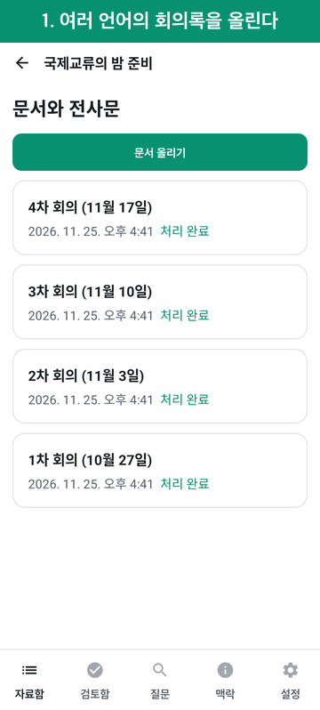
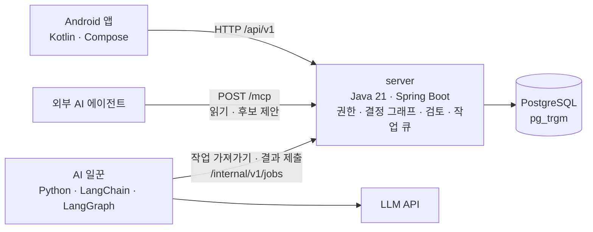
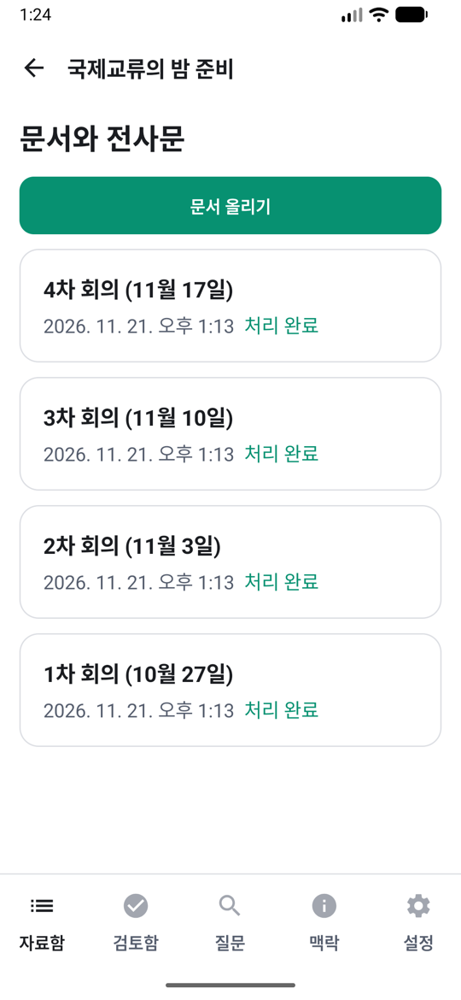
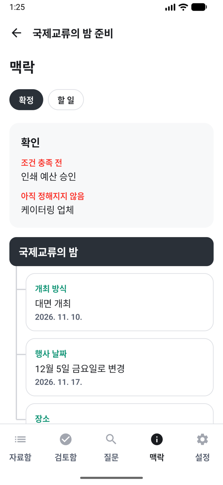
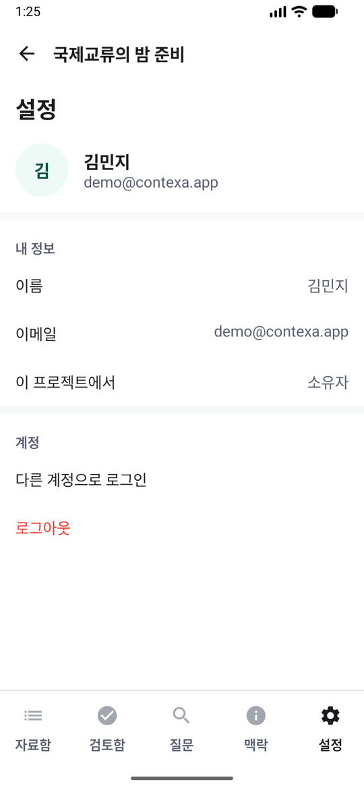

# Contexa


여러 언어가 섞인 회의록에서 **결정·조건·할 일**을 뽑아, 사람이 근거를 보고 확인한 것만 "지금의 결정"으로 쌓는 Android 앱과 MCP 커넥터입니다.

회의에 빠졌다가 돌아온 팀원이 "지금 어디까지 정해졌고, 왜 바뀌었고, 내가 할 일이 뭐지?"를 원문 발언까지 따라가며 확인할 수 있게 합니다. 한국어·영어·아랍어를 다룹니다.

<p align="center"></p>

## 왜 만들었나

기록이 없어서가 아니라, 흩어진 기록 속에서 **지금 유효한 결정**을 찾기 어려워서입니다. 2026년 11월 한국외대 구성원 설문(64명)에서:

- 협업 경험자 56명 중 40명(71.4%)이 과거 결정과 그 변경을 확인하는 데 어려움을 겪었습니다. 그중 25명은 정보가 흩어져 있어서, 20명은 변경 이유와 최종 상태를 알기 어려워서라고 답했습니다.
- 다국어 협업 경험자 23명 중 14명(60.9%)이 여러 언어가 섞인 발언을 이해하고 기록하는 데 어려움을 겪었습니다.

## 어떻게 동작하나

```
회의록 올리기 → AI가 후보를 뽑음 → 사람이 근거를 보고 확인 → 확정된 것만으로 답하고 추적
```

설계에서 지킨 것

- **AI는 후보만 낸다.** AI가 뽑은 카드는 모두 "검토 대기"로 저장되고, 사람이 확인하기 전에는 현재 결정을 바꾸지 않습니다.
- **모든 주장에는 원문 발언이 붙는다.** 모델은 발언 번호로만 근거를 대고, 일꾼과 server가 그 발언이 실제로 있는지, 요청한 사람이 읽을 수 있는지 각각 검사합니다. 답변의 인용도 같고, 인용이 하나도 없는 답은 저장하지 않습니다(근거를 찾지 못했다는 짧은 답만 예외).
- **결정은 덮어쓰지 않는다.** 바뀐 결정은 이전 결정을 대체하는 줄로 이어 이력으로 남깁니다. 확정된 결정이 둘이면 하나를 고르지 않고 "충돌"로 둡니다.
- **권한은 server가 판단한다.** 근거 발언을 볼 수 없는 사람에게는 그 카드도 보이지 않습니다(개인 메모 등).
- **추측하지 않는다.** 담당자·기한·조건이 불분명하면 채우지 않고, 이름이 비슷하다는 이유만으로 같은 사람으로 합치지 않습니다(`아흐마드 / Ahmed / أحمد`는 후보로만 묶고 사람이 확인).

## 평가

합성 회의록 4회와 정답 라벨([`data/synthetic/`](data/synthetic/))로 잰 값입니다. 실제로 돌려서 나온 숫자만 적습니다. 자세한 정의와 틀린 사례 분석은 [`eval/README.md`](eval/README.md)에 있습니다.

**결정 뽑기** — 모델 `claude-opus-5-5`, 지시문 `extract.v1`, 1회 실행(2026-11-25)

| | 정밀도 | 재현율 |
| --- | ---: | ---: |
| 카드(안건·결정·조건·할 일·인물) | 0.926 | 1.000 |
| 줄(카드 사이 관계) | 0.774 | 1.000 |
| 회의를 건너는 줄 | 0.750 | 1.000 |

- 확정되지 않은 발언("~하면 어떨까")을 확정 결정으로 뽑은 수: **0**
- 근거 발언이 정답 범위 안에 있음: 19/19, 이미 있는 카드를 중복으로 만든 수: 0
- 틀린 9건은 대부분 라벨이 좁았던 경우입니다(분석은 eval 문서). 자료가 작고 쉬워서, 더 길고 어려운 회의와 여러 번 실행한 편차를 재는 것이 다음 일입니다.

**근거 검색** — 글자 검색(pg_trgm)만, 결과 8개(2026-11-25)

| 질문 언어 | 한국어 | 영어 | 아랍어 | 섞어 씀 | 전체 |
| --- | ---: | ---: | ---: | ---: | ---: |
| recall@8 | 0.667 | 0.542 | 0.375 | 0.833 | 0.599 |

- 질문과 같은 언어로 적힌 정답 발언은 28개 중 27개를 찾았지만, **다른 언어로 적힌 정답 발언은 17개 중 0개**였습니다. 예를 들어 "When is the event now?"로는 날짜를 바꾼 한국어 발언을 찾지 못합니다.
- 실제 모델로 물어도 같았습니다. 영어로 워크숍 장소가 왜 바뀌었는지 물으면 한국어 발언 속 이유("강당이 공사라서")를 찾지 못해, 지어내지 않고 기록에 없다고 답했습니다.
- 다음 단계에서 다국어 임베딩(bge-m3)을 붙여 의미 검색과 글자 검색을 함께 쓰고, 같은 평가로 차이를 잽니다.

## 구조



- **server가 기록의 주인입니다.** 확정된 결정, 검토 이력, 권한을 server만 정합니다. LLM은 부르지 않습니다.
- **AI 일꾼은 DB에 접속하지 않습니다.** server의 작업 큐에서 일을 가져가 원문과 기존 카드를 읽고, 결과를 후보로 제출합니다. 오래 걸리는 작업은 임대를 늘려 가며 처리하고, 일꾼이 멈추면 임대가 풀려 다른 일꾼이 다시 시도합니다.
- **작업 안의 단계는 LangGraph로 잇습니다.** 질문에 답할 때는 검색어를 계획하고(질문을 프로젝트의 다른 언어로 옮긴 검색어 포함) 관련 안건을 지난 결정까지 따라 읽은 뒤, 근거가 모자라면 한 번 더 찾고 씁니다. 긴 회의록은 겹치는 창으로 나눠 동시에 뽑고 같은 카드를 합칩니다. 체크포인트는 두지 않습니다. 다시 하는 것은 server의 작업 재시도가, 사람의 판단은 검토함이 맡습니다.
- **결정은 카드와 줄의 그래프입니다.** 줄을 앞으로 따라가면 근거, 거꾸로 따라가면 영향입니다. 발언을 정정하면 거꾸로 따라가 그 발언에 기대던 할 일과 답변을 "다시 확인"으로 표시합니다(자동으로 고치지 않음).
- **모델은 바꿀 수 있습니다.** 모델 호출은 LangChain 어댑터 한 곳(`ai/contexa_ai/llm.py`)에만 있고 `CONTEXA_MODEL=공급자:모델`로 고릅니다. 지시문은 버전 붙은 파일(`prompts/*.vN.md`)로 관리합니다.

| 폴더 | 무엇 | 기술 |
|---|---|---|
| [`android/`](android/README.md) | 앱 | Kotlin, Jetpack Compose(Material 3), Navigation, Retrofit, kotlinx.serialization |
| `server/` | 권한, 결정 그래프, 검토, 작업 큐, MCP | Java 21, Spring Boot, PostgreSQL, Flyway, JdbcClient |
| [`ai/`](ai/README.md) | 문서를 발언으로 자르고, 후보를 뽑고, 답을 쓴다 | Python 3.11, LangChain, LangGraph, Langfuse(선택, 로컬) |
| [`eval/`](eval/README.md), [`data/synthetic/`](data/synthetic/) | 평가 스크립트, 합성 회의록과 정답 라벨 | Python |
| `docs/` | 설계 | [모듈과 API](docs/contexa_module_map.md), [시나리오](docs/contexa_sinario.md), [배포 계획](docs/contexa_deploy_plan.md) |

## 화면

| 자료함 | 원문 | 검토함 |
|:---:|:---:|:---:|
|  |  |  |
| 회의 전사문과 문서를 올린다 | 그 회의의 할 일·담당자와 발언 | AI가 뽑은 후보를 근거와 함께 확인 |

| 질문 | 맥락 | 설정 |
|:---:|:---:|:---:|
|  |  |  |
| 물은 언어로 답하고 근거는 원문 그대로 | 확정된 결정과 아직 남은 것 | 내 정보와 로그아웃 |

- **자료함**: 올린 회의록을 발언 단위로 잘라 보관합니다. 처리에 실패한 판은 다시 맡길 수 있습니다.
- **검토함**: AI 후보를 확인·보류·거절·철회합니다. 값을 고쳐서 확인하거나, 딸린 줄(담당·대체 등)을 하나씩 따로 판단할 수 있습니다. "다시 확인" 탭에는 근거가 정정되어 다시 봐야 하는 카드가 모입니다.
- **질문**: 대화하듯 묻고, "인수인계 브리핑"으로 새 팀원용 요약을 요청합니다. 인용을 누르면 원문 발언으로 갑니다. 근거를 찾지 못하면 답을 지어내지 않고 기록에 없다고 답합니다.
- **맥락**: 확정된 결정(안건별), 미해결 항목, 할 일의 상태와 수락, 결정 이력, 사람마다 언어별 이름 표기를 확인합니다.
- **설정**: 구성원 목록을 봅니다. 프로젝트 소유자는 가입한 사람을 이메일로 넣고 역할을 바꿉니다.

화면에 보이는 내용은 [시연용 데이터](#시연용-데이터로-둘러보기)입니다.

## MCP 커넥터

외부 AI 에이전트가 MCP(HTTP 방식)로 **확정된 결정을 읽고 새 후보를 제안**합니다. 확인·정정은 할 수 없습니다. 그것은 사람이 앱의 검토함에서 합니다.

| 도구 | 하는 일 |
|---|---|
| `current_state` | 지금 유효한 결정과 미해결 항목 |
| `decision_history` | 한 결정 항목이 어떻게 바뀌어 왔는지 |
| `trace` | 카드에서 근거(또는 영향) 쪽으로 줄 따라가기 |
| `search_evidence` | 원문 발언 검색 |
| `tasks` | 할 일과 담당자 |
| `resolve_entity` | 이름 표기로 사람·기관 찾기 |
| `verify_current` | 참고한 카드가 그사이 바뀌었는지 확인 |
| `propose_candidates` | 새 카드·줄을 후보로 제안(검토함으로 들어감) |

연결하기 (server를 띄우고 [시연용 데이터](#시연용-데이터로-둘러보기)를 넣은 뒤)

```sh
# 1. 로그인 토큰 → 프로젝트 id
curl -s -X POST http://127.0.0.1:8090/api/v1/auth/login \
  -H 'Content-Type: application/json' -d '{"email":"demo@contexa.app","password":"contexa-demo"}'
curl -s http://127.0.0.1:8090/api/v1/projects -H 'Authorization: Bearer <로그인 토큰>'

# 2. 그 프로젝트용 에이전트 토큰(프로젝트 소유자만). INTERNAL은 구성원이 읽는 문서까지, 기본 EXTERNAL은 외부 공유를 허용한 문서만
curl -s -X POST http://127.0.0.1:8090/api/v1/projects/<프로젝트 id>/agent-tokens \
  -H 'Authorization: Bearer <로그인 토큰>' -H 'Content-Type: application/json' -d '{"audience":"INTERNAL"}'
```

HTTP 방식을 지원하는 MCP 클라이언트 설정에 넣습니다.

```json
{
  "mcpServers": {
    "contexa": {
      "type": "http",
      "url": "http://127.0.0.1:8090/mcp",
      "headers": { "Authorization": "Bearer <에이전트 토큰>" }
    }
  }
}
```

- 에이전트 토큰은 발급된 프로젝트만 읽고, 개인 메모는 범위와 상관없이 읽지 못합니다.
- 브라우저에서 오는 요청(`Origin` 헤더가 붙은 요청)은 `contexa.mcp.allowed-origins`에 적은 곳만 받습니다. 기본값은 빈 목록입니다.

## 설치와 실행

배포된 서버와 APK는 아직 없습니다. 지금은 server를 자기 컴퓨터에 띄우고, 앱을 에뮬레이터나 USB로 연결한 기기에 설치합니다. 초대제 데모 서버 계획은 [`docs/contexa_deploy_plan.md`](docs/contexa_deploy_plan.md)에 있습니다.

### 준비물

- Docker
- JDK 21
- Android Studio (SDK API 37과 에뮬레이터 이미지 포함)
- AI 기능을 쓰려면 Python 3.11 이상과 모델 API 키

### 1. server

```sh
git clone https://github.com/dainkil/contexa.git
cd contexa
docker compose up -d db
(cd server && ./gradlew bootRun)        # 127.0.0.1:8090
```

### 2. AI 일꾼 (선택)

꺼져 있어도 앱은 열리지만, 새로 올린 문서와 질문은 처리 대기에 머뭅니다. 키는 레포 루트의 `.env`(git이 무시한다)에 적으면 일꾼이 읽습니다.

일꾼은 답을 만들기 위해 문서의 발언과 질문을 모델 공급자의 API로 보냅니다. 실제 회의록 대신 합성 자료([`data/synthetic/`](data/synthetic/))로 시험하세요. 일꾼의 호출 기록에는 원문을 남기지 않습니다.

```sh
echo 'ANTHROPIC_API_KEY=...' >> .env     # 레포 루트
cd ai
python3 -m venv .venv && source .venv/bin/activate
pip install -e .
python -m contexa_ai.worker
```

### 3. 앱

에뮬레이터를 켜거나 기기를 USB로 연결한 뒤:

```sh
cd android
./gradlew :app:installDebug
```

설치하면서 연결된 기기마다 8090 포트를 컴퓨터의 server로 돌립니다. 기기를 다시 켰다면 `./gradlew :app:reversePort`를 한 번 더 실행합니다. 내 휴대폰에서 보려면 USB 디버깅을 켜야 합니다([휴대폰 연결 방법](android/README.md#내-휴대폰에서-보기-usb)).

### 시연용 데이터로 둘러보기

server가 떠 있을 때 한 번 부르면 시연용 계정과 "국제교류의 밤 준비" 프로젝트가 만들어집니다. AI 일꾼 없이도 모든 화면에 볼 것이 있습니다.

```sh
curl -X POST http://127.0.0.1:8090/dev/demo
```

앱에서 아래 계정으로 로그인합니다.

| 이메일 | 비밀번호 |
|---|---|
| `demo@contexa.app` | `contexa-demo` |

둘러보는 순서는 [`android/README.md`의 시연 절](android/README.md#시연)에 있습니다. 이 주소는 개발용이라 `contexa.dev-seed.enabled`가 켜져 있을 때만 있습니다.

## 테스트

```sh
(cd android && ./gradlew :app:testDebugUnitTest)
(cd server && ./gradlew test)                                  # db가 떠 있어야 한다. 테스트는 같은 컨테이너의 contexa_test DB를 쓴다
(cd ai && python3 -m unittest discover -s tests -t .)          # 모델 없이 돈다
ai/.venv/bin/python -m unittest discover -s eval/tests -t .    # 레포 루트에서. 라벨·채점 확인
```

PR과 main push마다 GitHub Actions(`.github/workflows/ci.yml`)가 세 묶음을 모두 돌립니다. server는 PostgreSQL 서비스 컨테이너를 띄워 `./gradlew build`, ai는 단위 테스트와 평가 테스트, android는 단위 테스트와 debug 빌드입니다.

테스트가 막는 것: 다른 프로젝트·남의 개인 메모 접근, 확인하지 않은 후보가 확정으로 바뀌는 것, 원문에 없는 인용 저장, 정정된 정보가 이전 할 일·답변에 그대로 남는 것.

## 현재 상태

- 버전 0.1.0. Android 8.0(API 26) 이상에서 돕니다.
- 구현된 것: 자료함, 원문 뷰어, 검토함(다시 확인 포함), 질문과 인수인계 브리핑, 맥락(확정된 결정·할 일·이력·근거·이름 확인), MCP 커넥터, 평가 스크립트.
- 다음: 다국어 임베딩 검색, 더 큰 평가셋, 초대제 데모 서버와 서명된 APK.
- 화면 모양은 [SEED Design](https://github.com/daangn/seed-design)(Apache-2.0)의 토큰과 규격을 따릅니다.
- 라이선스는 아직 정하지 않았습니다.
