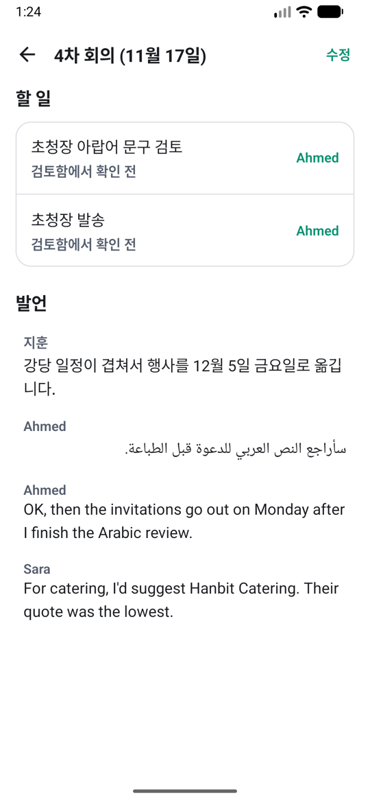
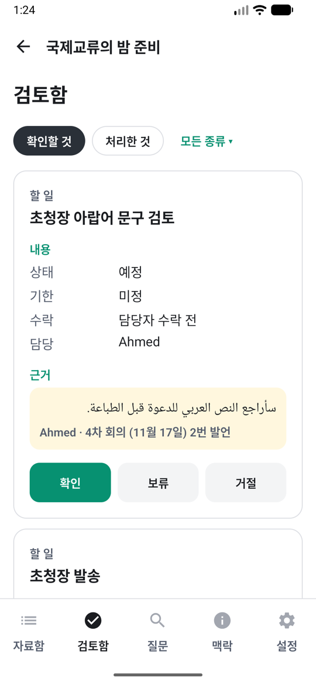
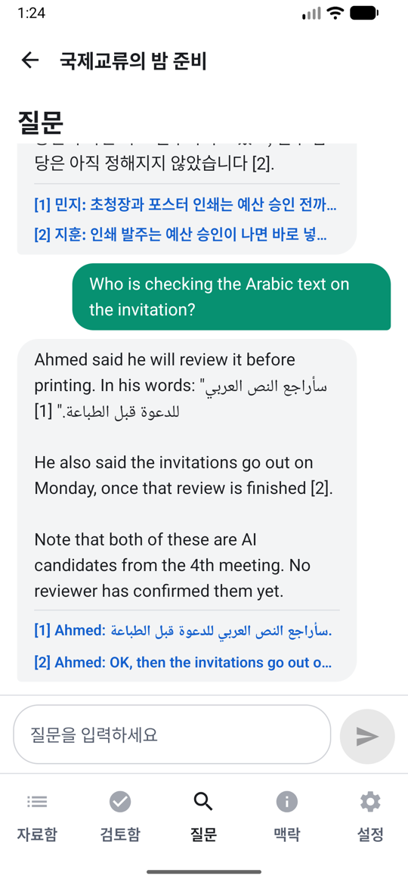

# Contexa


여러 언어가 섞인 회의록에서 **결정·조건·할 일**을 뽑아, 사람이 근거를 보고 확인한 것만 "지금의 결정"으로 쌓는 Android 앱입니다.

회의에 빠졌다가 돌아온 팀원이 "지금 어디까지 정해졌고, 내가 할 일이 뭐지?"를 원문 발언까지 따라가며 확인할 수 있게 하는 것이 목표입니다. 한국어·영어·아랍어를 다룹니다.

## 화면

| 자료함 | 원문 | 검토함 |
|:---:|:---:|:---:|
|  |  |  |
| 회의 전사문과 문서를 올린다 | 그 회의의 할 일·담당자와 발언 | AI가 뽑은 후보를 근거와 함께 확인 |

| 질문 | 맥락 | 설정 |
|:---:|:---:|:---:|
|  |  |  |
| 물은 언어로 답하고 근거는 원문 그대로 | 확정된 결정과 아직 남은 것 | 내 정보와 로그아웃 |

화면에 보이는 내용은 [시연용 데이터](#시연용-데이터로-둘러보기)입니다.

## 기능

- **자료함** — 회의 전사문과 문서를 올리면 발언 단위로 잘라 보관합니다. 문서를 열면 그 회의에서 나온 할 일과 담당자가 먼저 보입니다.
- **검토함** — AI가 뽑은 결정·조건·할 일 후보를 근거 발언과 함께 보고 확인·보류·거절합니다. 확인한 것만 사실로 씁니다.
- **질문** — 대화하듯 묻습니다. 질문을 쓴 언어로 답하고, 문장마다 근거 발언이 붙습니다. 근거를 누르면 원문으로 갑니다.
- **맥락** — 확정된 결정을 안건별로 보여 주고, 충족되지 않은 조건이나 아직 정해지지 않은 항목을 따로 알려 줍니다. 할 일은 상태를 바꾸고, 내가 맡은 일은 수락하거나 거절합니다.
- **설정** — 내 정보를 보고 로그아웃합니다.

## 구성

```
Android 앱  ──HTTP──▶  server  ◀──작업 가져가기/결과 제출──  AI 일꾼
(Kotlin)              (Spring Boot)                        (Python · Claude)
                          │
                      PostgreSQL
```

| 폴더 | 무엇 | 기술 |
|---|---|---|
| [`android/`](android/README.md) | 앱 | Kotlin, Jetpack Compose(Material 3), Navigation, Retrofit, kotlinx.serialization |
| `server/` | 권한, 결정 그래프, 검토, 작업 큐 | Java 21, Spring Boot, PostgreSQL(pgvector), Flyway |
| [`ai/`](ai/README.md) | 문서를 발언으로 자르고, 후보를 뽑고, 답을 쓴다 | Python 3.11, Anthropic SDK |
| `docs/` | 기획과 설계 | [구조](docs/contexa_architecture.md), [모듈과 API](docs/contexa_module_map.md), [시나리오](docs/contexa_sinario.md) |

## 설치와 실행

배포된 APK나 서버는 아직 없습니다. 지금은 server를 자기 컴퓨터에 띄우고, 앱을 에뮬레이터나 USB로 연결한 기기에 직접 설치해서 씁니다.

### 준비물

- Docker
- JDK 21
- Android Studio (SDK API 37과 에뮬레이터 이미지 포함)
- AI 기능을 쓰려면 Python 3.11 이상과 Anthropic API 키

### 1. server

```sh
git clone https://github.com/dainkil/contexa.git
cd contexa
docker compose up -d db
(cd server && ./gradlew bootRun)        # 127.0.0.1:8090
```

### 2. AI 일꾼 (선택)

꺼져 있어도 앱은 열리지만, 새로 올린 문서와 질문은 처리 대기에 머뭅니다.

```sh
cd ai
python3 -m venv .venv && source .venv/bin/activate
pip install -e .
export ANTHROPIC_API_KEY=...
python -m contexa_ai.worker
```

### 3. 앱

에뮬레이터를 켜거나 기기를 USB로 연결한 뒤:

```sh
cd android
./gradlew :app:installDebug
```

설치하면서 기기의 8090 포트를 컴퓨터의 server로 돌립니다. 기기를 다시 켰다면 `./gradlew :app:reversePort`를 한 번 더 실행합니다. 자세한 내용은 [`android/README.md`](android/README.md)에 있습니다.

### 시연용 데이터로 둘러보기

server가 떠 있을 때 한 번 부르면 시연용 계정과 "국제교류의 밤 준비" 프로젝트가 만들어집니다. AI 일꾼 없이도 모든 화면에 볼 것이 있습니다.

```sh
curl -X POST http://127.0.0.1:8090/dev/demo
```

앱에서 아래 계정으로 로그인합니다.

| 이메일 | 비밀번호 |
|---|---|
| `demo@contexa.app` | `contexa-demo` |

둘러보는 순서는 [`android/README.md`의 시연 절](android/README.md#시연)에 있습니다. 이 주소는 개발용이라 `contexa.dev-seed.enabled`가 켜져 있을 때만 있습니다.

## 테스트

```sh
(cd android && ./gradlew :app:testDebugUnitTest)
(cd server && ./gradlew test)                        # db가 떠 있어야 한다
(cd ai && python3 -m unittest discover -s tests -t .)
```

## 현재 상태

- 버전 0.1.0. Android 8.0(API 26) 이상에서 돕니다.
- 구현된 것: 자료함, 원문 뷰어, 검토함, 질문, 맥락(확정된 결정·할 일·이력·근거), 설정.
- 아직 없는 것: 배포(지금은 내 컴퓨터에서만 돕니다), 이름 검토 화면, 위키, 초안 작성. 계획은 [`docs/contexa_deploy_plan.md`](docs/contexa_deploy_plan.md)에 있습니다.
- 화면 모양은 [SEED Design](https://github.com/daangn/seed-design)(Apache-2.0)의 토큰과 규격을 따릅니다.
- 라이선스는 아직 정하지 않았습니다.
