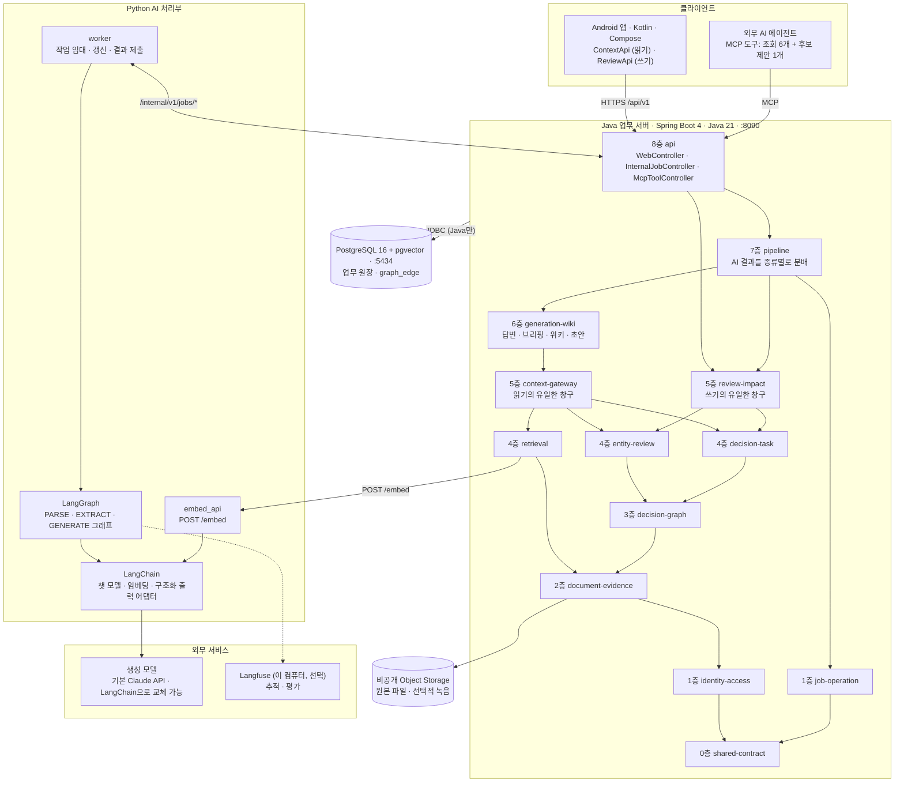
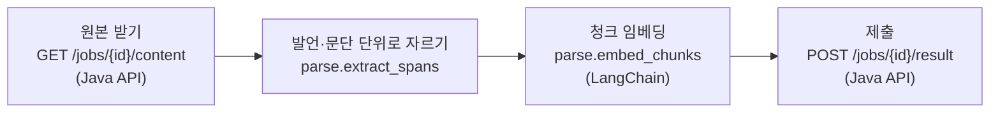
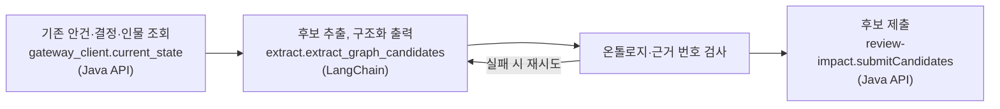
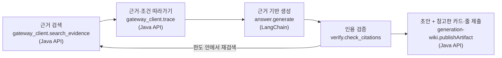
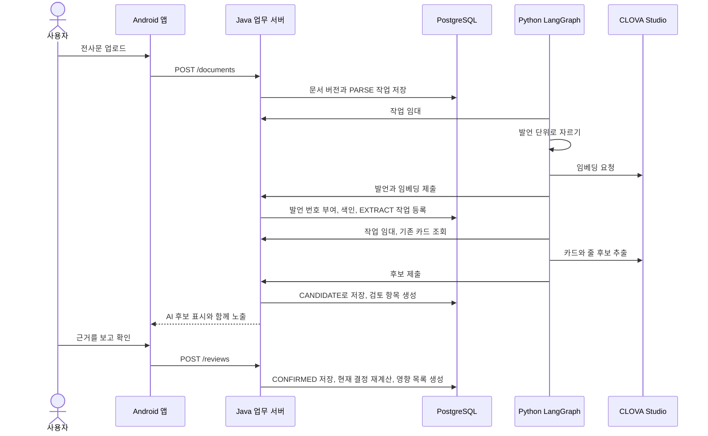
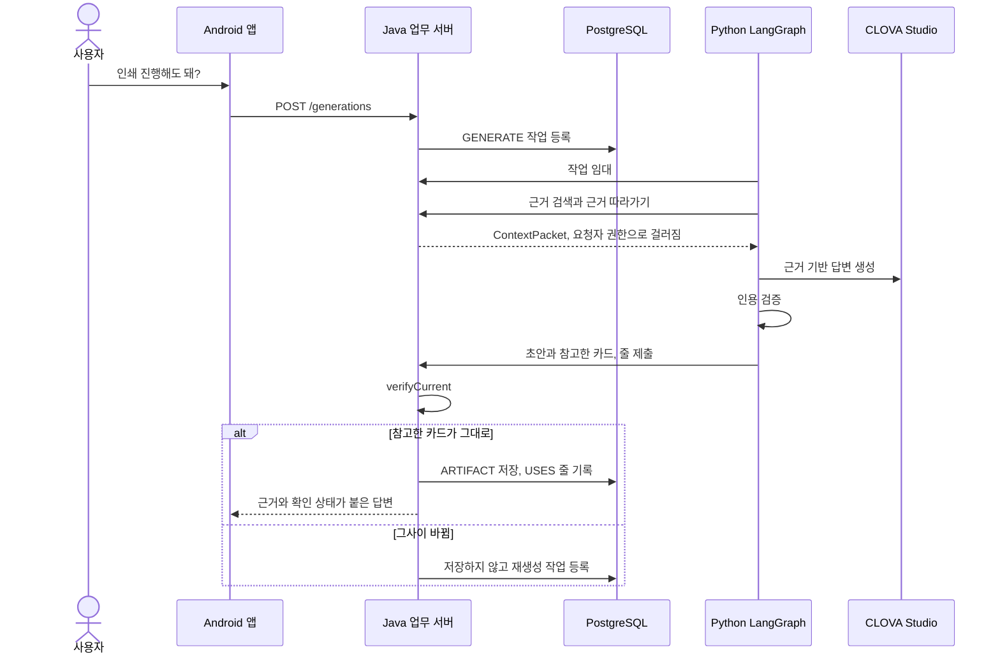

# Contexa 아키텍처

> 작성일: 2026-11-15 · 고친 날: 2026-11-21(클라이언트를 Android 앱으로, 구현 상태 갱신), 2026-11-24(LangChain·LangGraph·Langfuse 역할 확정, 9장 1·2번 결정) · 대상: 개발팀 · 근거: 제안서 부록 A, 모듈 지도 v2, `server/` 코드를 대조해 정리

Java 모듈형 모놀리스 하나가 업무 기록과 규칙을 모두 갖고, Python AI 처리부가 LangGraph로 분석·생성을 돌려 후보만 제출하는 구조다. 저장소는 PostgreSQL 하나다.

## 1. 먼저 답부터

| 질문 | 답 |
|---|---|
| LLM 위키를 쓰나? | 쓴다. 다만 제품이 아니라 방식이다. 확인된 결정과 원문으로 안건별 페이지 갱신안을 LLM이 만들고, 사람이 검토해 버전으로 쌓는다. 서버에서는 `generation-wiki` 모듈이 맡고, 위키 페이지는 `ARTIFACT` 노드로 저장된다. |
| LangChain · LangGraph · Langfuse는? | 셋 다 Python AI 처리부 안에서만 쓴다. LangChain은 모델·임베딩 연결(모델을 바꿔도 이 어댑터만 바뀐다), LangGraph는 작업 한 번 안의 단계 제어, Langfuse는 추적·평가다. Java 서버는 이 셋을 모른다. LangSmith는 쓰지 않는다(4.4). |
| 지금 어디까지 만들었나? | (2026-11-21 기준) Java 13개 모듈 전부, Python AI 일꾼(자르기·후보 뽑기·답변), Android 앱(자료함·검토함·질문·맥락)이 동작한다. LangChain 계열, 임베딩 검색, 위키, 파일 저장소는 아직 없다. 자세한 것은 8장. |

## 2. 전체 구성

Java 서버의 모듈은 모두 구현됐다. Python 쪽은 일꾼 하나이고, 모델 연결을 LangChain으로 옮기고 Langfuse 추적을 붙이는 중이다(11/24). LangGraph 그래프, `embed_api`, Object Storage는 아직 없다(8장). LangGraph 체크포인트는 두지 않기로 했다(9장 1번).

모듈별 역할:

| 층 | 모듈 | 맡는 일 | 상태 |
|---|---|---|---|
| 8 | `api` | 요청을 알맞은 모듈로 넘긴다. 번역만 한다 | 미착수 |
| 7 | `pipeline` | AI 결과를 종류별로 분배 (PARSE → EXTRACT → GENERATE) | 미착수 |
| 6 | `generation-wiki` | 답변·브리핑·위키·초안의 요청과 버전 저장. 저장 직전 `verifyCurrent` | 미착수 |
| 5 | `context-gateway` | 읽기의 유일한 창구. 항상 `ContextPacket` 반환 | 미착수 |
| 5 | `review-impact` | 쓰기의 유일한 창구. 후보 접수, 확인, 영향 추적 | 미착수 |
| 4 | `retrieval` | 벡터 + 이름·별칭 검색 | 미착수 |
| 4 | `entity-review` | 인물·기관, 언어별 표기 | 미착수 |
| 4 | `decision-task` | 안건·결정·조건·업무, 현재 결정 계산 | 미착수 |
| 3 | `decision-graph` | 줄 추가, 상태 전이, 근거(BASIS)·영향(IMPACT) 탐색, 낙관적 잠금 | **구현됨** |
| 2 | `document-evidence` | 문서 버전, 발언·문단 단위 원문 구간 | 미착수 |
| 1 | `identity-access` | 인증, 자료 열람 권한, 에이전트 토큰 | 미착수 |
| 1 | `job-operation` | 영속 작업 큐: 임대, 재시도, 중복 방지 | 미착수 |
| 0 | `shared-contract` | `NodeType`, `RelType`, `ReviewStatus`, `Edge`, `Ontology.isAllowed` | **구현됨** |

위층은 아래층만 호출하고, 같은 층끼리는 호출하지 않는다. 정확한 의존 표는 [모듈 지도](contexa_module_map.md) 부록 B.1을 따른다.

## 3. 구조를 고정하는 규칙 다섯 가지

1. **읽기는 `context-gateway`로만.** 화면, Q&A, 외부 AI가 같은 답과 같은 확인 상태를 받는다.
2. **쓰기는 `review-impact`로만.** 확인, 정정, 보류, 담당 수락, 업무 상태 변경이 모두 여기를 거친다.
3. **AI는 `CANDIDATE`만 낸다.** `CONFIRMED`는 근거를 본 사람만 찍을 수 있고, 근거 없는 확인은 거절된다.
4. **관계의 상태는 `graph_edge`에만 적는다.** 방향은 항상 기대는 쪽 → 기댈 대상이다. 앞으로 따라가면 근거, 거꾸로 따라가면 영향이다.
5. **근거를 볼 수 없으면 카드와 줄도 보이지 않는다.** 작업(JOB)은 요청한 사용자의 권한으로 조회한다.

## 4. Python AI 처리부 안: LangGraph 그래프 세 개

노드 구성은 모듈 지도 부록 B.9의 함수와 제안서 A.5 흐름을 그래프로 옮긴 **안**이다. 2026-11-24 계획에서는 EXTRACT·GENERATE만 LangGraph로 만들고, PARSE는 규칙 함수로 둔다. GENERATE에는 질의 계획·다국어 질의 확장·근거 충분성 판단 루프를, EXTRACT에는 창 나누기(Send)·병합을 더한다. 그래프 상태는 작업 한 번 동안만 살고, 실패 복구는 Java 작업 임대·재시도가 맡는다.

### 4.1 PARSE · 문서 자르기

발언 번호가 먼저 있어야 다음 단계가 근거를 적을 수 있다.

### 4.2 EXTRACT · 카드와 줄 후보 뽑기

기존 카드를 먼저 받아 중복 생성을 막는다.

### 4.3 GENERATE · 답변, 브리핑, 위키 갱신안, 초안

근거가 부족하면 지어내지 않고 확인 필요로 답한다.

제출 후 Java가 `verifyCurrent`로 그사이 바뀐 카드가 없는지 확인하고, 바뀌었으면 저장하지 않고 재생성을 요청한다.

### 4.4 세 도구가 맡는 곳

| 도구 | 맡는 곳 | 주의 |
|---|---|---|
| LangChain | 모델 호출 세 지점: 임베딩, 구조화된 후보 추출, 생성. 모델 제공업체를 바꿀 때 이 어댑터만 바꾼다 | 임베딩 모델·차원·전처리 버전은 벡터와 함께 기록한다 |
| LangGraph | 작업 한 번 안의 단계 순서, 검증 실패 시 고치기, 검색 루프 | 체크포인터·`interrupt`를 쓰지 않는다. 복구는 Java 작업 임대·재시도가, 사람 검토는 Java DB의 검토 항목이 맡는다 |
| Langfuse | 호출 추적(토큰·지연·모델·프롬프트 버전, `project_id`·`job_id` 태그)과 고정 평가 세트 비교 | 이 컴퓨터에만 띄운다. 추적 로그는 업무 기록이 아니다. LangSmith는 무료 플랜이 클라우드 전용이고 자체 설치가 Enterprise 전용이라 회의 내용이 외부로 나가므로 쓰지 않는다 |

## 5. 흐름 1 · 자료를 올리고 사람이 확인하기까지

## 6. 흐름 2 · 질문에 답하기

외부 AI가 MCP로 같은 질문을 해도 `context-gateway`의 같은 함수를 거치므로 같은 근거와 같은 확인 상태를 받는다.

## 7. LLM 위키가 이 구조에서 놓이는 자리

- **무엇인가.** 안건별 현재 상태, 배경, 변경 과정, 미해결 사항을 누적 정리한 페이지다(FR-060, FR-061). 새 자료나 확인·정정이 생기면 LLM이 갱신안을 만들고, 기존 버전과 비교해 사람이 반영한다.
- **어떻게 저장되나.** 위키 페이지도 답변·초안과 같은 `ARTIFACT` 노드다. 만들 때 참고한 카드마다 `USES` 줄이 그어지고, 그 카드가 바뀌면 영향 탐색에 걸려 다음에 열 때 재확인 필요로 표시된다.
- **지키는 선.** 위키는 원본에서 다시 만들 수 있는 파생 자료다. 위키만으로 사실을 확정하지 않고, 주요 사실은 원문과 검토 기록으로 확인한다. 공용 위키에는 프로젝트 공용 자료만 쓴다.

## 8. 기술 스택과 현재 상태

| 영역 | 기술 | 맡는 일 | 상태 |
|---|---|---|---|
| 업무 서버 | Java 21 · Spring Boot 4 · JdbcClient · Flyway | 권한, 상태 전이, 결정 그래프, 작업 큐, 감사 | 13개 모듈 구현 |
| 데이터 | PostgreSQL 16 · pgvector | 업무 원장, 그래프, 임베딩 검색 | 원장·그래프 구현. 임베딩 검색은 없고 글자 일치로 찾는다 |
| AI 처리부 | Python | 작업 워커, `/embed` | 일꾼 구현(server 통신은 표준 라이브러리). `/embed`는 미착수(임베딩 검색과 함께 붙인다) |
| 모델 연결 | LangChain | 챗 모델, 임베딩, 구조화 출력 어댑터 | `llm.py`가 LangChain 어댑터다(`init_chat_model`, 11/24) |
| 처리 흐름 | LangGraph | EXTRACT·GENERATE 단계 제어 | 미착수(평가 기준선을 만든 다음) |
| 평가·추적 | Langfuse(로컬) + `eval/` | 언어별 평가, 프롬프트·모델 비교, 지연·오류 추적 | 추적(호출 로그 줄·Langfuse)은 구현(11/24), 평가셋은 미착수 |
| 생성 모델 | Claude API(기본), LangChain으로 교체 가능 | 후보 추출, 질의응답, 브리핑·초안·위키 | Claude로 후보 추출과 답변을 만든다. 다른 모델은 평가셋으로 비교한 뒤 쓴다 |
| 지식 축적 | LLM 기반 누적 위키 | 안건별 페이지 갱신안과 버전 | 미착수 |
| 클라이언트 | Android · Kotlin · Jetpack Compose | 자료함, 검토함, 질문·답변, 결정 현황·이력, 업무, 위키, 초안 | 자료함·원문 뷰어, 검토함, 대화형 질문, 맥락(확정된 결정·확인할 것·할 일·이력·근거), 설정(내 정보·로그아웃) 구현. 새 판 올리기·카드 고치기·계정 연결·브리핑은 화면에서 뺐다. 이름 검토, 위키, 초안 편집은 미착수. React 웹은 2026-11-21에 지웠다 |
| 외부 연결 | MCP | 게이트웨이 조회 6개 + 후보 제안 | `McpController` 구현 |
| 파일 | 비공개 Object Storage | 원본 파일, 선택적 녹음 | 미착수 |

## 9. 팀에서 정해야 할 것

제안서(부록 A)와 모듈 지도(v2)가 서로 다르게 말하거나, 한쪽에만 적혀 있는 부분이다.

1. ~~**LangGraph 체크포인트를 어디에 두나.**~~ **결정(11/24): 두지 않는다.** 그래프 상태는 작업 한 번 동안만 살고, 복구는 Java 작업 임대·재시도로 한다. Python은 계속 DB에 접속하지 않는다.
2. ~~**모듈 지도에 LangChain 계열이 없다.**~~ **결정(11/24):** LangChain은 `llm.py` 안의 모델 어댑터로만, LangGraph는 EXTRACT·GENERATE 그래프로 쓴다(4장). 노드와 재시도 한도는 LangGraph로 옮길 때 코드로 정하고 모듈 지도 부록 B.9에 적는다.
3. **위키의 서버 쪽 설계가 얇다.** 모듈 이름은 `generation-wiki`지만 공개 함수에는 위키 전용 동작(안건별 페이지, 갱신안 비교, 반영)이 아직 없다. `GenKind`에 위키를 넣는 정도로 끝나는지 확인이 필요하다.
4. **의존 관계 저장 방식.** 제안서는 `resource_revision`·`dependency` 테이블을, 모듈 지도는 `graph_edge`의 `USES` 줄을 쓴다. 날짜가 더 늦은 모듈 지도가 대체한 것으로 읽었지만 명시된 적은 없다.
