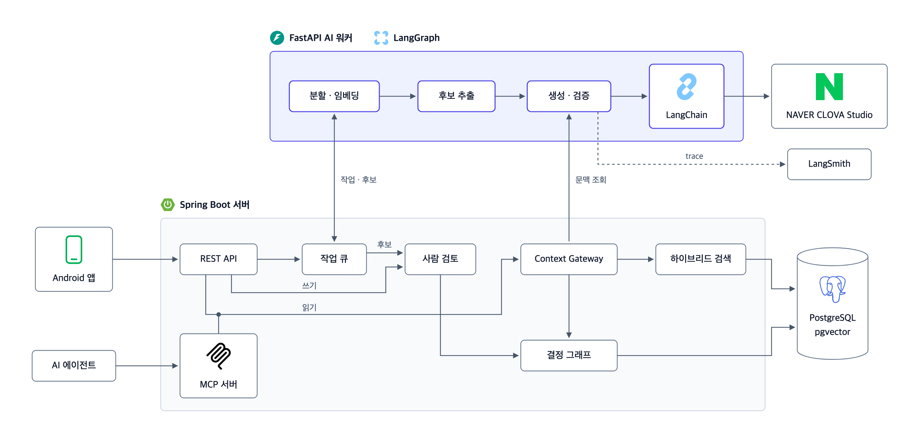
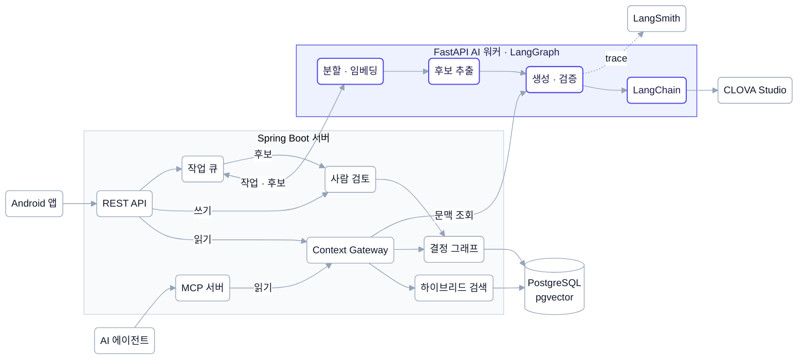

# Contexa 시스템 아키텍처 (포트폴리오용)

다국어 회의·문서에서 결정과 근거를 추출해 결정 그래프로 쌓고, 사람이 확인한 사실만 확정으로 쓰는 AI 협업 서비스.

위 이미지의 원본은 `contexa_architecture_portfolio.svg`다. 아래 Mermaid는 같은 구조를 텍스트로 옮긴 것이다.

## 설계 포인트

- **AI는 후보만, 확정은 사람이.** LLM 출력은 모두 `CANDIDATE`로 저장되고, 근거를 확인한 사람만 `CONFIRMED`로 바꿀 수 있다.
- **읽기·쓰기 창구를 하나씩.** 앱, Q&A, 외부 에이전트(MCP)가 같은 Context Gateway를 거쳐 같은 근거와 확인 상태를 받는다.
- **결정 그래프로 근거와 영향을 추적.** 모든 관계를 "기대는 쪽 → 기댈 대상" 한 방향으로 저장해, 앞으로 따라가면 근거, 거꾸로 따라가면 정정의 영향 범위가 나온다.
- **AI 처리부는 DB를 직접 건드리지 않는다.** 내부 API로 작업을 가져가고, 요청한 사용자의 권한으로 걸러진 문맥만 받는다.
- **생성 결과는 저장 직전에 다시 검증.** 답변이 참고한 카드가 그사이 바뀌었으면 저장하지 않고 재생성한다.
