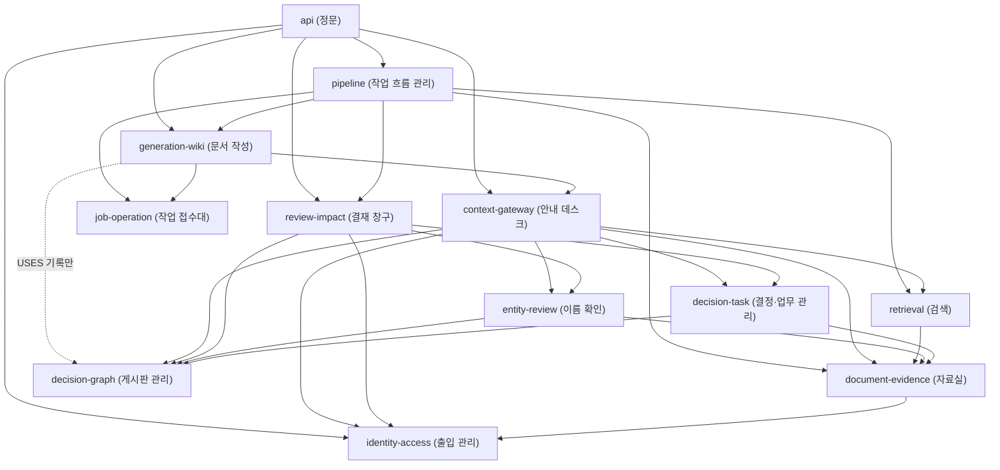

# Contexa 모듈 지도

> 작성일: 2026-11-14 (v2: 실행 흐름 점검 반영) · 대상: 직접 구현할 사람 · 범위: 맥락 게이트웨이, 결정 온톨로지·결정 그래프를 중심으로 한 서버 구조
>
> 본문(1~8장)은 개발을 몰라도 읽을 수 있게 썼고, 코드로 옮길 때 필요한 이름과 시그니처는 부록에 모았다.

Contexa를 만들기 전에 "프로그램을 어떤 부서들로 나누고, 누가 누구에게 일을 부탁하는지"를 정한 문서다. 스택은 기존 합의대로 Java(Spring Boot) 업무 서버, Python AI 처리부, Android 앱(처음 합의는 React 웹이었고 2026-11-21에 바꿨다), PostgreSQL이다.

## 1. 왜 지도부터 그리나

회사를 세울 때 사무실 자리 배치(파일 구조)보다 **부서와 보고 체계**(모듈 지도)를 먼저 정하는 것과 같다. 부서가 정해지면 자리는 자연스럽게 따라온다. 반대로 자리부터 정하면, 누가 누구에게 일을 넘기는지가 그때그때 편한 대로 정해져 나중에 엉킨다.

| 용어 | 쉬운 뜻 |
|---|---|
| 모듈 | 한 가지 일을 책임지는 부서 |
| 함수 | 그 부서 창구에서 받아주는 업무 한 가지 |
| 의존 | A 부서가 B 부서에게 일을 부탁하는 것 |

## 2. 먼저 정하는 공통 약속: 카드와 줄

벽에 카드를 붙이고 실로 잇는 수사 게시판을 떠올리면 된다. 이것이 **결정 그래프**이고, "어떤 카드와 어떤 줄을 쓸 수 있는지" 정한 규칙이 **결정 온톨로지**다.

카드 6종 (여기에 AI가 만든 답변·초안 카드가 하나 더 있다):

| 카드 | 예시 |
|---|---|
| 안건 | 국제교류 행사 |
| 결정 | "대면 개최로 확정" |
| 조건 | 예산 승인 |
| 할 일 | 인쇄 발주 |
| 인물·기관 | Ahmed Hassan, NUR Labs |
| 발언 | 3차 회의 22번 발언 |

카드를 잇는 줄 (대표적인 것):

| 줄 | 뜻 | 예시 |
|---|---|---|
| 필요로 한다 | 이게 되려면 저 조건이 필요 | 인쇄 발주 → 예산 승인 |
| 근거다 | 이 내용은 저 발언에서 나왔다 | 예산 승인 조건 → 22번 발언 |
| 대체한다 | 새 결정이 옛 결정을 바꿨다 | 대면 개최 → 온라인 개최 |
| 맡는다 | 이 일의 담당자 | 아랍어 문구 검토 → Ahmed Hassan |
| 가리킨다 | 발언 속 이름이 실제 누구인지 | 22번 발언 → Ahmed Hassan |
| 참고했다 | 이 답변·초안이 보고 만든 카드 | 영어 메일 초안 → 인쇄 발주 |

**줄의 방향은 항상 "기대는 쪽 → 기댈 대상"이다.** 인쇄 발주는 예산 승인에 기대고, 예산 승인 조건은 22번 발언에 기댄다. 그래서 줄을 앞으로 따라가면 "왜 그런가(근거)"가 나오고, 거꾸로 따라가면 "이걸 고치면 무엇이 흔들리나(영향)"가 나온다.

카드와 줄에는 모두 확인 상태가 있다.

- **연필**: AI가 "이럴 것 같다"고 낸 후보.
- **도장**: 사람이 근거를 보고 확인한 것.

연필은 확정된 사실로 쓰지 않는다. 다만 숨기지도 않는다. 자료를 올린 직후에도 "AI 후보"라는 표시와 함께 보여준다. 이 구분이 Contexa의 핵심이다.

## 3. 부서 13개

| 부서 (비유) | 하는 일 | 코드 이름 |
|---|---|---|
| 공통 양식 | 카드·줄·답변서의 양식을 정한다. 일은 하지 않는다 | `shared-contract` |
| 출입 관리 | 누구인지 확인하고, 볼 수 있는 자료를 정한다 | `identity-access` |
| 작업 접수대 | AI에게 맡길 일을 줄 세우고 결과를 받는다 | `job-operation` |
| 자료실 | 올린 문서를 보관하고 발언·문단 단위로 잘라 번호를 붙인다 | `document-evidence` |
| 게시판 관리 | 줄을 긋고, 규칙에 맞는 줄인지 검사하고, 줄을 따라가 준다 | `decision-graph` |
| 이름 확인 | 인물·기관 카드와 이름 표기를 관리한다 | `entity-review` |
| 결정·업무 관리 | 안건·결정·조건·할 일 카드를 관리하고 "지금 유효한 결정"을 계산한다 | `decision-task` |
| 검색 | 질문과 관련된 발언·문단을 찾는다 | `retrieval` |
| 결재 창구 | 결정 정보를 바꾸는 유일한 곳. AI 후보 접수, 사람의 확인·정정, 담당 수락을 처리하고 고친 내용의 영향을 찾는다 | `review-impact` |
| **안내 데스크** | 결정에 관한 질문에 답하는 유일한 곳 (= 맥락 게이트웨이). 읽기만 한다 | `context-gateway` |
| 문서 작성 | 답변·브리핑·메일 초안을 만든다 | `generation-wiki` |
| 작업 흐름 관리 | 분석 단계를 순서대로 잇고, AI가 낸 결과를 알맞은 부서에 넘긴다 | `pipeline` |
| 정문 | 화면·AI·외부 프로그램의 요청을 받아 알맞은 부서로 넘긴다 | `api` |

회사 밖에 **AI 인턴**(Python `ai-pipeline`)이 따로 있다. 문서를 읽고 후보와 답변 초안을 써서 제출하기만 한다.

## 4. 꼭 지킬 규칙

1. **물어볼 때는 안내 데스크로만.** 화면이든 Q&A든 외부 AI든, 결정 정보는 안내 데스크를 거쳐서만 받는다. 그래야 누가 물어도 같은 답, 같은 확인 상태가 나온다.
2. **바꿀 때는 결재 창구로만.** 확인, 정정, 보류, 담당 수락, 업무 상태 변경은 모두 결재 창구를 거친다.
3. **AI 인턴은 연필만 쓴다.** AI와 외부 프로그램은 후보를 낼 뿐, 도장을 찍거나 게시판을 직접 고치지 못한다.
4. **줄의 상태는 게시판 한 곳에만 적는다.** "이 이름은 이 사람을 가리킨다", "이 일은 이 사람이 맡는다" 같은 관계를 다른 부서 장부에 따로 적지 않는다. 두 곳에 적으면 언젠가 어긋난다.
5. **근거를 볼 수 없는 사람에게는 그 카드와 줄도 보이지 않는다.** 개인 메모에서 나온 내용은 메모 주인에게만 보인다.

안내 데스크가 돌려주는 답변서(**맥락 패킷**)는 항상 같은 양식이다: 사실 목록, 사실마다 확인 상태(연필/도장)와 근거 발언, 아직 확인 안 된 것, 기준 시점.

## 5. 누가 누구에게 부탁할 수 있나

건물 층으로 생각한다. **위층은 아래층에만 부탁할 수 있고, 아래층은 위층을 모른다. 같은 층끼리도 부탁하지 않는다.**

```
8층  정문
7층  작업 흐름 관리
6층  문서 작성
5층  안내 데스크        결재 창구
4층  검색    이름 확인    결정·업무 관리
3층  게시판 관리
2층  자료실
1층  출입 관리    작업 접수대
0층  공통 양식
```

## 6. 실제로 돌아가는 흐름

### 6.1 자료를 올리면

1. 사용자가 3차 회의 전사문을 올린다. **정문**이 **작업 흐름 관리**에 넘긴다.
2. 작업 흐름 관리가 **자료실**에 문서를 보관하고, **작업 접수대**에 "① 문서 자르기"를 올린다.
3. **AI 인턴**이 문서를 발언 단위로 자르고 검색용 색인을 만들어 제출한다. 작업 흐름 관리가 발언은 자료실에, 색인은 **검색**에 넘긴다. 이때 발언마다 번호가 붙는다.
4. 작업 흐름 관리가 "② 카드와 줄 뽑기"를 올린다. ①과 ②를 나눈 이유는, 발언 번호가 먼저 있어야 "이 카드의 근거는 22번 발언"이라고 적을 수 있기 때문이다.
5. AI 인턴이 **안내 데스크**에서 이 프로젝트에 이미 있는 안건·결정·인물을 받아 본다. 그래야 2차 회의에서 만든 "행사 방식" 카드를 또 만들지 않고 거기에 새 사건을 잇는다.
6. AI 인턴이 카드·줄 후보를 제출하면 작업 흐름 관리가 **결재 창구**에 넘긴다. 결재 창구가 연필로 저장하고 검토 항목을 만든다. '아흐마드'처럼 후보가 둘이면 연필 줄이 두 개 생긴다.
7. 이 시점부터 화면에는 "AI 후보" 표시가 붙은 내용이 보인다.

### 6.2 사람이 확인하면

검토는 줄 하나씩이 아니라 **카드 묶음 단위**로 한다. 예를 들어 "인쇄 발주" 카드를 열면 그 카드에 달린 근거·조건·담당 줄이 함께 보이고, 한 번에 확인하거나 틀린 줄만 고친다.

1. 검토자가 화면에서 "확인"을 누른다. **정문**이 **결재 창구**에 넘긴다.
2. 결재 창구가 카드와 줄에 도장을 찍고, 결정이 바뀌는 경우 **결정·업무 관리**에게 "지금 유효한 결정"을 다시 계산하게 한다.
3. 그 카드에 기대고 있던 것들을 거꾸로 따라가 영향 목록을 만든다.

### 6.3 질문하면 — "인쇄 진행해도 돼?"

1. **정문**이 질문을 **문서 작성**에 넘기고, 문서 작성이 **작업 접수대**에 "답변 만들기"를 올린다.
2. **AI 인턴**이 **안내 데스크**에 묻는다: "인쇄 관련 발언 찾아줘." 안내 데스크는 AI 인턴이 아니라 **질문한 사용자의 권한**으로 찾는다.
3. 안내 데스크가 **검색**으로 3차 회의 22·23번 발언을 찾고, **게시판 관리**에게 그 발언에 기대고 있는 카드를 묻는다: 조건 "예산 승인", 할 일 "인쇄 발주".
4. AI 인턴이 다시 묻는다: "인쇄 발주의 근거를 따라가 줘."
   `인쇄 발주 —필요로 한다→ 예산 승인 —근거다→ 22번 발언`
5. 안내 데스크가 **결정·업무 관리**에서 각 카드의 상태를 받아 답변서에 담는다: "예산 승인: 미충족".
6. AI 인턴이 답변을 쓴다: "예산 승인 전이라 인쇄는 보류입니다. (근거: 22번 발언)"
7. **문서 작성**이 저장 직전에 안내 데스크에 확인한다: "답변이 참고한 카드가 그사이 바뀌지 않았나?" 바뀌었으면 저장하지 않고 다시 만든다.
8. 저장하면서 "이 답변은 이 카드들을 참고했다" 줄을 긋는다.

외부 AI가 같은 질문을 해도 2~5번을 똑같이 거치므로 같은 답이 나온다.

### 6.4 나중에 고치면

누군가 22번 발언의 이름 연결을 정정하면, **결재 창구**가 줄을 거꾸로 따라간다: 22번 발언 → 그 발언에 기댄 할 일 → 그 할 일을 참고한 답변·초안. 영향받은 답변은 다음에 열 때 "다시 확인 필요"로 표시된다.

## 7. 만드는 순서

| 순서 | 만들 것 | 끝나면 되는 것 |
|---|---|---|
| 1 | 공통 양식 | 카드·줄의 종류와 "허용되는 줄" 규칙이 정해짐 |
| 2 | 게시판 관리 | 줄을 긋고 따라갈 수 있음 |
| 3 | 결정·업무 관리 | 카드를 저장하고 현재 결정을 계산함 |
| 4 | 안내 데스크 | "인쇄 발주의 근거를 따라가 줘"에 답변서가 나옴 |
| 5 | 정문 | 개발용 페이지(브라우저)에서 4번을 눈으로 확인 |
| 6 | 출입 관리, 자료실, 결재 창구, 이름 확인 | 로그인, 자료 등록, 도장 찍기 |
| 7 | 작업 접수대, 작업 흐름 관리, AI 인턴, 검색, 문서 작성, 외부 AI 연결 | AI가 후보와 답변을 만듦 |

1~5번은 AI 없이, 손으로 넣은 예시 카드만으로 동작한다.

## 8. v2에서 고친 것 (실행 흐름 점검 결과)

초안을 실제 실행 순서대로 따라가 보며 찾은 문제와 고친 내용이다.

| # | 문제 | 고친 내용 |
|---|---|---|
| 1 | 줄 방향이 제각각이라 "근거 쪽으로 따라가기"가 줄 종류마다 앞·뒤가 달랐다 | 모든 줄을 "기대는 쪽 → 기댈 대상"으로 통일. `ABOUT`(사건→항목)을 `HAS_EVENT`(항목→사건)로, `USED_BY`(카드→답변)를 `USES`(답변→카드)로 변경 |
| 2 | 카드 자체가 AI 후보인지 표시할 곳이 없었다 | 확인 상태를 카드와 줄이 함께 쓰도록 `EdgeStatus`를 `ReviewStatus`로 변경 |
| 3 | 같은 관계를 게시판과 다른 부서 장부에 이중으로 적게 되어 있었다 | 관계 상태는 `graph_edge`에만 저장 (규칙 4) |
| 4 | 카드를 고칠 때마다 줄이 끊어지는 구조였다 | 줄은 카드의 id로 잇고, 리비전은 "줄을 그을 때 본 버전"으로만 기록 |
| 5 | AI가 발언과 카드를 한 번에 제출하면 근거로 적을 발언 번호가 아직 없다 | 분석을 "자르기"와 "뽑기" 두 작업으로 분리 |
| 6 | 회의마다 같은 안건·인물 카드가 중복 생성된다 | 뽑기 전에 안내 데스크에서 기존 카드를 받아 거기에 잇도록 함 |
| 7 | 모든 줄에 도장이 찍혀야 보이면, 자료를 올린 직후 화면이 텅 빈다 | 안내 데스크가 후보도 "AI 후보" 표시와 함께 반환. 검토는 카드 묶음 단위 |
| 8 | AI 인턴이 물을 때 누구 권한으로 찾는지 정해져 있지 않았다 | 작업에 기록된 요청자 권한으로 조회 (`Caller.onBehalfOf`) |
| 9 | 개인 메모에서 나온 카드가 모두에게 보일 수 있었다 | 근거를 볼 수 있는 사람에게만 표시 (규칙 5) |
| 10 | 외부 AI가 글로 검색하면 Java 서버가 검색용 숫자(임베딩)를 만들 방법이 없었다 | 검색 부서가 Python의 변환 창구를 호출. 꺼져 있으면 이름·별칭 검색만 수행 |
| 11 | 프로젝트에 무엇이든 바뀌면 생성 중이던 답변이 전부 막혔다 | 답변이 실제로 참고한 카드·줄이 바뀐 경우에만 막음 (`verifyCurrent`) |
| 12 | 담당 수락 확인에 같은 층 부서끼리 부탁해야 했다 | 수락·업무 상태 변경도 결재 창구를 거치게 함 (규칙 2) |
| 13 | 정문이 AI 결과를 종류별로 나눠 주는 일까지 하고 있었다 | `pipeline` 부서 신설 |
| 14 | 조건 상태를 엉뚱한 함수(`currentDecision`)로 읽고 있었다 | 카드 상태를 읽는 `getNodes` 추가 |

구현하면서 더 고친 것:

| # | 문제 | 고친 내용 |
|---|---|---|
| 15 | 할 일끼리의 선후, 할 일 완료로 풀리는 조건을 표현할 수 없었다 | 필요로 한다에 할 일 → 할 일, 충족됐다에 조건 → 할 일 조합 추가 |
| 16 | "온라인 제안"도 결정 사건이라 현재 결정으로 계산될 수 있었다 | 사건에 유형을 두고, 확정·변경만 현재 결정 후보로 삼음 (FR-044, FR-040) |
| 17 | 확정된 결정이 둘일 때의 상태가 없어, 최신 것을 고르는 수밖에 없었다 | `CONTESTED` 상태 추가. 사람이 대체 줄을 확인해야 하나로 정해짐 (FR-047) |
| 18 | 조건 상태를 사람이 적고 충족 줄도 따로 두면 둘이 어긋날 수 있었다 | 조건 상태는 충족 줄에서 계산. `setConditionState`를 `recomputeCondition`으로 변경 |
| 19 | 새 줄이 생겨 결정이 바뀌어도 기존 카드·줄의 버전은 그대로라, 답변이 낡았는지 알 수 없었다 | 계산 결과를 카드에 적고 바뀌면 카드 버전을 올림 |
| 20 | 줄이 바뀐 뒤 무엇을 다시 계산해야 하는지 호출하는 쪽이 기억해야 했다 | `onEdgeChanged` 하나로 모음 |
| 21 | 검토 묶음을 "기대는 쪽 카드" 기준으로만 나누면, 새 사건을 확인할 때 항목–사건 줄이 다른 묶음에 있었다 | `HAS_ITEM`·`HAS_EVENT`는 아래쪽 카드의 묶음에 딸리게 함 |
| 22 | 근거 없이도 카드를 확인할 수 있었고, 제안이 확정을 대체하는 줄도 확인할 수 있었다 | 결재 창구가 확인 전에 근거·유형·건너편 카드를 검사 (NFR-009) |
| 23 | 없는 발언이나 읽을 수 없는 문서의 발언을 근거로 댈 수 있었다 | 후보 제출과 확인 때 발언의 존재와 열람 권한을 검사 (FR-039) |
| 24 | 답변서에 근거 발언의 id만 있고 원문이 없었다 | 답변서에 `sources`(읽을 수 있는 발언의 원문) 추가 |
| 25 | 문서 열람 범위를 자료실에 두면 아래층인 출입 관리가 읽을 수 없었다 | 열람 범위(`document_acl`)를 출입 관리가 갖고, 자료실이 등록 |
| 26 | 카드 내용(`NodeView`)이 결정·업무 관리 패키지에 있어 이름 확인이 같은 층을 참조해야 했다 | `NodeView`를 공통 양식으로 옮김 |
| 27 | "줄을 확인할 때 본 카드 버전 기록"은 카드 버전이 상태 변화마다 올라 의미가 없었다 | 하지 않기로 함. 영향은 `traverse(IMPACT)`로 구함 |
| 28 | 작업 결과를 받다가 실패하면(틀린 후보, 낡은 근거) 작업이 어중간한 상태로 남을 수 있었다 | 결과 받기를 한 트랜잭션으로 묶음. 실패하면 받지 않은 것으로 되돌아가고 일꾼이 같은 임대증으로 고쳐서 다시 냄 |
| 29 | 온톨로지 규칙을 Python에도 적으면 Java와 어긋날 수 있었다 | 규칙표를 서버에서 받아 감(`/internal/v1/jobs/ontology`) |
| 30 | 모델이 id를 직접 다루면 없는 발언·카드를 지어내도 구분할 수 없었다 | 모델에게는 이름표(s1, x1, f1)만 보여 주고 실제 id는 일꾼이 붙임 |
| 31 | 답변은 요청자의 권한으로 읽은 내용으로 쓰이는데, 다른 구성원도 열 수 있으면 개인 메모 내용이 샐 수 있었다 | 산출물은 요청한 사람만 읽음 |
| 32 | 답변의 인용이 실제 발언을 가리키는지 확인할 곳이 없었다 | 일꾼이 한 번, 서버가 저장 전에 한 번 검사 (FR-039) |
| 33 | 에이전트 토큰이 모두 "외부용"이라, 팀이 직접 쓰는 AI 도구도 거의 아무것도 읽지 못했다 | 토큰을 발급할 때 범위(EXTERNAL/INTERNAL)를 정하게 함. 기본값은 EXTERNAL |
| 34 | MCP 라이브러리가 Spring Boot 4와 맞는지 확인되지 않았다 | 라이브러리 없이 HTTP 방식의 최소 형태를 직접 구현 (메서드 4개) |

---

## 부록 A. 공통 계약 (`shared-contract`, 패키지 `contract`)

모든 모듈이 의존하고, 이 모듈은 아무것도 의존하지 않는다.

```
enum NodeType     { TOPIC, DECISION_ITEM, DECISION_EVENT, CONDITION, TASK, ENTITY, SPAN, ARTIFACT }
enum RelType      { HAS_ITEM, HAS_EVENT, SUPERSEDES, WITHDRAWS, REQUIRES, SATISFIED_BY,
                    DERIVED_FROM, ASSIGNED_TO, EVIDENCED_BY, SPOKEN_BY, MENTIONS,
                    USES, CONFLICTS_WITH }
enum ReviewStatus { CANDIDATE, CONFIRMED, HELD, REJECTED, RETRACTED }   // 카드와 줄이 함께 씀
enum Direction    { BASIS /* 기댈 대상 쪽: 줄을 앞으로 */, IMPACT /* 기대는 쪽: 줄을 거꾸로 */ }

record NodeRef(NodeType type, UUID id, long revision)
record Edge(UUID id, UUID projectId, RelType rel, NodeRef src, NodeRef dst,
            ReviewStatus status, List<UUID> evidenceSpanIds,
            UUID confirmedBy, Instant confirmedAt, String ontologyVersion, long version)
record EdgeRef(UUID id, long version)

record Caller(Kind kind /* USER | JOB | AGENT */, UUID id, UUID projectId,
              UUID onBehalfOf /* JOB일 때 요청한 사용자 */, Audience audience /* INTERNAL | EXTERNAL */)
record EvidenceRef(NodeRef span, UUID edgeId, ReviewStatus status)        // 근거 발언과 그 "근거다" 줄의 상태
record Fact(NodeRef node, ReviewStatus status, String label, Map<String,String> states,
            UUID confirmedBy, Instant confirmedAt, List<EvidenceRef> evidence)
record OpenIssue(Kind kind /* HELD_NODE | HELD_EDGE | CONTESTED_DECISION | UNMET_CONDITION | AMBIGUOUS_NAME | NEEDS_RECHECK */,
                 NodeRef node, UUID edgeId)
record Scope(UUID projectId, View view /* TRACE | CURRENT_STATE | DECISION_HISTORY */,
             NodeRef focus, Direction direction, Integer depth)
record ContextPacket(Instant asOf, Scope scope, List<Fact> facts, List<Edge> relations, List<OpenIssue> open)
record StaleRef(NodeRef node, EdgeRef edge, Long currentVersion)          // 참고한 뒤 바뀐 카드나 줄

record NodeDraft(String key, NodeType type, Map<String,Object> fields)
record EdgeDraft(RelType rel, String srcKey, NodeRef srcRef, String dstKey, NodeRef dstRef,
                 List<UUID> evidenceSpanIds)      // 새 카드는 key로, 기존 카드는 NodeRef로 가리킴
record GraphCandidates(List<NodeDraft> nodes, List<EdgeDraft> edges)

Ontology.isAllowed(RelType rel, NodeType src, NodeType dst) : boolean
```

줄에 관한 약속:

- 줄은 양끝 카드의 `type + id`로 이어진다. `revision`은 줄을 긋거나 확인할 때 본 버전을 기록한 것이다. 카드가 고쳐져도 줄은 끊어지지 않고, "옛 버전을 보고 확인한 줄"임을 알 수 있다.
- 카드의 근거는 `EVIDENCED_BY` 줄로, 줄의 근거는 `evidenceSpanIds`로 적는다. 줄에는 줄을 달 수 없기 때문이다.
- `CONFLICTS_WITH`만 "기댄다"는 뜻이 없는 줄이라 근거·영향 탐색에서 제외한다.
- `USES`는 시스템이 기록하는 사실이라 검토 없이 `CONFIRMED`로 저장한다.

허용 조합 (`Ontology.isAllowed`의 내용). 방향은 모두 기대는 쪽 → 기댈 대상:

| 본문의 줄 | 관계 | 출발 → 도착 |
|---|---|---|
| (안건의 항목) | `HAS_ITEM` | TOPIC → DECISION_ITEM |
| (항목에 일어난 사건) | `HAS_EVENT` | DECISION_ITEM → DECISION_EVENT |
| 대체한다 / 철회한다 | `SUPERSEDES`, `WITHDRAWS` | DECISION_EVENT → DECISION_EVENT |
| 필요로 한다 | `REQUIRES` | DECISION_ITEM, TASK → CONDITION / TASK → TASK (할 일의 선후) |
| 충족됐다 | `SATISFIED_BY` | CONDITION → SPAN (발언으로 충족) / CONDITION → TASK (할 일 완료로 충족) |
| (결정에서 나온 일) | `DERIVED_FROM` | TASK → DECISION_ITEM |
| 맡는다 | `ASSIGNED_TO` | TASK → ENTITY |
| 근거다 | `EVIDENCED_BY` | DECISION_EVENT, CONDITION, TASK → SPAN |
| (말한 사람) / 가리킨다 | `SPOKEN_BY`, `MENTIONS` | SPAN → ENTITY |
| 참고했다 | `USES` | ARTIFACT → ARTIFACT를 뺀 모든 노드 |
| (충돌한다) | `CONFLICTS_WITH` | DECISION_EVENT → DECISION_EVENT, SPAN |

"결정" 카드는 코드에서 둘로 나뉜다. `DECISION_ITEM`은 "행사 방식"처럼 정해야 할 항목이고, `DECISION_EVENT`는 "온라인 제안", "대면 확정"처럼 그 항목에 대해 일어난 사건이다.

## 부록 B. 모듈 의존과 공개 함수

### B.1 의존 표

| 모듈 | 층 | 부를 수 있는 모듈 |
|---|---|---|
| `shared-contract` | 0 | 없음 |
| `identity-access` | 1 | contract |
| `job-operation` | 1 | contract |
| `document-evidence` | 2 | identity |
| `decision-graph` | 3 | contract |
| `retrieval` | 4 | document (+ Python 임베딩 창구) |
| `entity-review` | 4 | (지금은 다른 모듈을 부르지 않는다) |
| `decision-task` | 4 | graph, document |
| `context-gateway` | 5 | identity, document, graph, retrieval, entity-review, decision-task |
| `review-impact` | 5 | identity, document, graph, entity-review, decision-task |
| `generation-wiki` | 6 | gateway, job, graph(`recordSystemEdge`만) |
| `pipeline` | 7 | job, document, retrieval, review-impact, generation-wiki |
| `api` | 8 | pipeline, gateway, review-impact, generation-wiki, identity |



모든 모듈은 `shared-contract`를 쓴다(그림에서는 생략).

금지 규칙 (나중에 자동 검사로 옮길 것):

1. `api`·`pipeline`·`generation-wiki`는 `decision-graph`·`decision-task`·`entity-review`의 조회 함수를 직접 부르지 않는다. 읽기는 `context-gateway`만 한다.
2. 결정 정보를 바꾸는 함수(`confirm*`, `set*`, `accept*`, `change*`, `setEdgeStatus`)는 `review-impact`만 부른다.
3. 후보(AI 결과, 외부 에이전트 제안)는 `review-impact.submitCandidates`로만 들어온다.
4. 관계의 상태는 `graph_edge`에만 저장한다. 다른 모듈의 테이블에 담당자·연결 대상·대체 대상 컬럼을 두지 않는다.
5. Python은 DB에 접속하지 않고 내부 API만 부른다.

### B.2 `decision-graph`
```
addCandidateEdge(Edge e) : UUID            // CANDIDATE만 받음. 같은 살아 있는 줄이 있으면 그 id를 돌려줌
recordSystemEdge(Edge e) : UUID            // USES 전용
setEdgeStatus(UUID edgeId, ReviewStatus s, UUID reviewer, List<UUID> evidence, long expectedVersion) : Edge
find(UUID edgeId) : Optional<Edge>
edgesOf(UUID projectId, NodeRef node, Direction d, Set<RelType> rels, Set<ReviewStatus> statuses) : List<Edge>
edgesOfMany(UUID projectId, Collection<NodeKey> nodes, Direction d, Set<RelType> rels,
            Set<ReviewStatus> statuses) : List<Edge>          // 여러 카드에 붙은 줄을 한 번에
traverse(UUID projectId, NodeRef start, Direction d, Set<RelType> rels, int maxDepth,
         Set<ReviewStatus> statuses) : Subgraph
currentVersions(UUID projectId, Collection<UUID> edgeIds) : Map<UUID, Long>
```
- 허용되지 않은 조합은 `Edge`를 만드는 시점에 거절된다(`contract`). 양끝 카드가 실제로 있고 같은 프로젝트인지는 카드를 소유한 위층 모듈이 확인한 뒤 호출한다.
- `traverse`는 한 칸씩 넓혀 가며(칸마다 조회 1회, 최대 10칸) 방문한 카드를 기억해 같은 카드를 두 번 지나지 않는다. `CONFLICTS_WITH`는 따라가지 않는다. 결과 `Subgraph`에는 지난 줄과 카드별 최단 거리가 담긴다.
- 상태 변화는 후보·보류 → 확인·보류·거절, 확인 → 철회만 허용한다. 거절·철회된 줄은 이력으로 남고, 다시 제안하면 새 줄이 된다.
- 확인하려면 근거가 하나 이상 있어야 하고, `expectedVersion`이 현재와 다르면 거절한다.

### B.3 `decision-task`
```
saveCandidates(UUID projectId, List<NodeDraft> drafts) : Map<String, NodeRef>   // key → 저장된 카드. 하나라도 틀리면 전부 취소
getNodes(UUID projectId, Collection<NodeRef> refs) : List<NodeView>     // 카드 내용, 확인 상태, 종류별 상태
listNodes(UUID projectId, NodeType type, Set<ReviewStatus> statuses) : List<NodeView>
currentRevisions(UUID projectId, Collection<NodeRef> refs) : Map<NodeKey, Long>
currentDecision(UUID decisionItemId) : DecisionState    // 저장값을 믿지 않고 줄에서 다시 계산(읽기 전용)
setNodeStatus(NodeRef node, ReviewStatus s, UUID reviewer, long expectedRevision) : NodeRef
recomputeProjection(UUID decisionItemId) : DecisionState
recomputeCondition(UUID conditionId) : ConditionState
onEdgeChanged(Edge e)                                   // 줄 상태를 바꾼 뒤 호출. 걸린 계산 결과를 다시 계산
changeTaskStatus(UUID taskId, TaskStatus s, UUID actor, long expectedRevision) : NodeRef
recordAcceptance(UUID taskId, UUID accountId, boolean accepted) : NodeRef

// Rechecks: 다시 확인할 카드의 장부(테이블 recheck, V12). 남기고 닫는 것은 review-impact만 부른다
Rechecks.mark(UUID projectId, Collection<RecheckMark> marks /* 카드, 바뀐 것, 거리 */, RecheckReason r, UUID actor) : int
Rechecks.openOf(UUID projectId, Collection<NodeKey> nodes) : Map<NodeKey, List<RecheckCause>>
Rechecks.listOpen(UUID projectId, int limit, OffsetDateTime afterSince, UUID afterId) : List<OpenRecheck>
Rechecks.resolve(UUID projectId, NodeKey node, UUID by, RecheckResolution KEPT|REVIEWED) : int
```
- 소유하는 카드는 `TOPIC`, `DECISION_ITEM`, `DECISION_EVENT`, `CONDITION`, `TASK`다. 카드 사이의 연결은 저장하지 않고 `decision-graph`에 묻는다.
- 결정 사건에는 유형이 있다: `PROPOSAL`(제안), `DISCUSSION`(논의), `DEFERRAL`(보류), `DECISION`(확정), `CHANGE`(변경), `WITHDRAWAL`(철회). 현재 결정이 될 수 있는 것은 확정과 변경뿐이다.
- 현재 결정 계산: 확인된 `HAS_EVENT` 줄로 이어진 확인된 사건만 본다. 사건이 확인된 `WITHDRAWS` 줄을 받으면 `WITHDRAWN`, `SUPERSEDES` 줄을 받으면 `SUPERSEDED`, 아니면 `ACTIVE`다(줄을 그은 사건 카드도 확인 상태여야 센다). 살아 있는 확정·변경 사건이 없으면 `UNDECIDED`(한 번도 없었음) 또는 `WITHDRAWN`(있었지만 모두 끝남), 하나면 `DECIDED`, 둘 이상이면 `CONTESTED`다. 최신 사건이 저절로 이기지 않는다.
- 조건 상태 계산: 확인된 `SATISFIED_BY` 줄이 발언을 가리키거나, 확인되고 완료(`DONE`)된 할 일을 가리키면 `MET`, 아니면 `UNMET`이다. 사람이 상태를 직접 적지 않는다. 충족을 되돌리려면 그 줄을 철회한다.
- 계산 결과(항목의 현재 결정, 사건의 지위, 조건 상태)는 카드에 적어 두고, 바뀌면 카드 버전을 올린다. 행이 바뀌면 항상 버전이 1 오른다.
- 카드 확인 상태나 업무 상태가 바뀌면 걸린 계산 결과를 이 모듈이 스스로 다시 계산한다. 줄 상태가 바뀐 경우는 `review-impact`가 `onEdgeChanged`를 불러야 한다.
- 진행 상태 변경과 수락은 확인된 할 일에만 할 수 있다.
- "다시 확인"(`Rechecks`): 결정 사건·조건·할 일 가운데 확인·보류된 것만 남는다(후보는 이미 검토함에 있다). 안건·결정 항목은 사건을 담을 뿐이고 현재 결정은 다시 계산되므로 남기지 않는다. 한 카드에 이유가 여럿 쌓일 수 있고, 같은 카드·같은 원인으로는 열린 것이 하나뿐이다. 닫으면 그 카드의 열린 이유가 모두 닫히고, 닫은 행도 지우지 않는다. 이유(`RecheckReason`)는 `REVIEW`, `NAME`, `ACCOUNT`, `CONDITION`, `SPAN_REVISION`.

### B.4 `entity-review`
```
saveCandidates(UUID projectId, List<NodeDraft> drafts) : Map<String, NodeRef>   // name, kind, names{언어: 표기}
getNodes(UUID projectId, Collection<NodeRef> refs) : List<NodeView>
currentRevisions(UUID projectId, Collection<NodeRef> refs) : Map<NodeKey, Long>
getNameCard(UUID projectId, UUID entityId) : NameCard
namesOf(UUID projectId, Collection<UUID> entityIds) : Map<UUID, List<NameForm>>   // 여러 인물의 표기를 한 번에(검토함용)
findCandidates(UUID projectId, String surface, String lang) : List<EntityCandidate>
entityOfAccount(UUID projectId, UUID accountId) : Optional<UUID>
setNodeStatus(NodeRef node, ReviewStatus s, UUID reviewer, long expectedRevision) : NodeRef
updateFields(NodeRef node, Map<String,Object> fields, long expectedRevision) : NodeRef
confirmName(UUID projectId, UUID entityId, String lang, String form, UUID reviewer, UUID evidenceSpanId) : NodeRef
rejectName(UUID projectId, UUID entityId, String lang, String form) : NodeRef
linkAccount(UUID projectId, UUID entityId, UUID accountId /* null이면 끊기 */) : NodeRef
```
- 서로 다른 사실을 따로 확인한다: 카드의 확인 상태(이 인물이 있다), 표기마다의 확인 상태(이 언어로는 이렇게 적는다), 계정 연결(이 인물이 이 계정이다). 하나를 확인해도 다른 것은 바뀌지 않는다.
- 확인되지 않은 음역·번역은 제안 표기(`CANDIDATE`)로 남고, 거절된 표기는 이름 찾기에 쓰이지 않는다.
- `findCandidates`는 대소문자와 앞뒤 공백을 무시하고, 표기 전체가 같은 것을 먼저 돌려준다. 후보가 여럿이어도 하나로 고르지 않는다.
- 계정은 확인된 인물(`PERSON`) 카드에만, 한 프로젝트에서 카드 하나에만 연결된다.

"이 발언의 이 이름은 이 사람"은 `MENTIONS` 줄의 상태이므로 여기가 아니라 `decision-graph`에 저장된다.

### B.5 `review-impact`
```
submitCandidates(Caller source, GraphCandidates c) : List<UUID>      // 누구나. 연필로 저장하고 검토 묶음을 만든다
listReviews(Caller c, ReviewFilter f /* state, ownerType, limit, after */) : ReviewPage   // {items, next}
getReview(Caller c, UUID reviewId) : ReviewItem
applyAction(Caller c, UUID reviewId, ReviewAction a, long expectedVersion, String idempotencyKey) : ReviewResult
changeTaskStatus(Caller c, UUID taskId, TaskStatus s, long expectedRevision) : Changed   // 구성원
acceptTask(Caller c, UUID taskId, boolean accepted) : Changed                             // 담당자 본인만
satisfyCondition(Caller c, UUID conditionId, NodeRef by /* 발언 또는 할 일 */, List<UUID> evidence) : Changed
confirmName(Caller c, UUID entityId, String lang, String form, UUID evidenceSpanId) : Changed
rejectName(Caller c, UUID entityId, String lang, String form) : Changed
linkAccount(Caller c, UUID entityId, UUID accountId) : Changed
reviseSpan(Caller c, UUID spanId, long expectedRevision, String text) : Changed
listImpacts(UUID projectId, NodeRef changed) : List<Impact>
listRechecks(Caller c, Integer limit, String after) : RecheckPage          // {items: [{review, causes}], next}
resolveRecheck(Caller c, NodeKey node) : RecheckResolved                   // 검토자만. "바뀐 것 없음"
```
- 검토함은 쪽을 나눠 읽는다. 확인할 것(OPEN)은 오래된 묶음부터, 처리한 것(DONE)은 최근에 바뀐 묶음부터 나온다. `limit` 기본 50, 최대 200. 다음 쪽은 `next`를 `after`로 보낸다. 근거를 하나도 읽을 수 없는 묶음은 빠지므로 `items`가 `limit`보다 적어도 `next`가 있을 수 있다.
- 묶음 수와 상관없이 정해진 횟수만 DB를 읽는다(카드·줄·건너편 카드·발언을 한 번씩 모아 읽는다).
- `ReviewItem`에는 카드와 줄 말고도 `related`(줄 건너편 카드)와 `sources`(줄이 가리키거나 근거로 대는 발언의 원문)가 실린다. 기준은 `context-gateway`와 같다: 원문은 읽을 수 있는 문서의 것만, 건너편 카드는 근거 줄이 있는데 하나도 읽을 수 없으면 뺀다(줄은 그대로 `edges`에 있다).
- 인물·기관 묶음에는 `names`(언어별 표기 전부: 확인·제안·거절과 표기의 근거 발언 id)가 더 실리고, `sources`에는 그 인물을 언급한(`MENTIONS`) 발언과 표기의 근거 발언이 더해진다. 다른 종류의 묶음에서 `names`는 비어 있다. 같은 사람으로 합치는 판단은 없다.
- **검토 묶음**: 카드 한 장과 그 카드에 딸린 줄. 줄은 기대는 쪽(`src`) 카드에 딸린다. 다만 `HAS_ITEM`·`HAS_EVENT`는 아래쪽 카드(항목, 사건)에 딸린다. 새 사건을 확인할 때 "어느 항목의 사건인지"도 함께 확인해야 하기 때문이다. `MENTIONS`·`SPOKEN_BY`는 발언에 딸리며, 그 묶음에는 카드 판단 없이 줄마다 판단을 내린다. 묶음은 카드마다 하나이고, 새 후보가 들어오면 다시 열린다.
- **판단**(`Verdict`): `CONFIRM`, `HOLD`, `REJECT`, `RETRACT`. 따로 판단하지 않은 줄은 카드 판단을 따라간다. 내용 정정(`corrections`)을 함께 할 수 있다.
- **권한**: 확인·정정은 사람이면서 프로젝트의 OWNER·REVIEWER만 한다. AI 작업과 외부 에이전트는 `submitCandidates`만 할 수 있다. 업무 상태는 구성원이면 바꾼다. 업무 수락은 계정이 확인된 인물 카드에 연결되어 있고, 그 인물로 가는 `ASSIGNED_TO` 줄이 확인된 본인만 한다.
- **확인할 때 지키는 것**: (1) 결정 사건·조건·할 일은 확인된 근거 줄이 하나 이상 있어야 확인 상태일 수 있다. (2) 카드가 확인되지 않았으면 딸린 줄도 확인할 수 없다. (3) 건너편 카드가 없거나 거절·철회됐으면 그 줄은 확인할 수 없다(건너편이 후보인 것은 괜찮다). (4) 대체 줄은 확정·변경 사건끼리만, 철회 줄은 철회 사건에서 확정·변경 사건으로만 확인한다. 하나라도 어기면 아무것도 바꾸지 않는다.
- **근거**: 줄 후보에는 근거 발언이 하나 이상 있어야 하고, 그 발언은 자료실에 실제로 있으며 내는 사람(AI 작업이면 요청한 사용자)이 읽을 수 있는 문서의 것이어야 한다. 묶음의 근거를 하나도 읽을 수 없는 사람에게는 그 묶음이 보이지 않는다.
- **처리 후**: 줄마다 `decision-task.onEdgeChanged`를 불러 계산 결과를 맞추고, 바뀐 카드에서 `decision-graph.traverse(IMPACT)`로 영향받는 카드 목록을 구해 돌려준다. 응답의 영향 목록은 그때그때 계산한다.
- **다시 확인**: 확인된 것이 바뀌었을 때만, 거기에 기대는(영향 목록의) 확인·보류된 결정 사건·조건·할 일을 `decision-task`의 `Rechecks`에 남긴다. 남기는 경우: 확인된 카드의 정정·철회, 확인된 줄의 철회, 확정을 대체·철회하는 줄의 확인(대체된 사건에 기대던 카드), 확인된 표기의 거절, 이미 연결된 계정의 변경·해제, 조건 충족 확인, 발언 정정. 후보를 처음 확인하는 일, 표기를 새로 확인하는 일, 처음 계정을 연결하는 일, 할 일의 진행 상태·수락은 새 정보라서 남기지 않는다. 어떤 카드의 묶음을 처리하면(`applyAction`) 그 카드의 "다시 확인"은 `REVIEWED`로 닫히고, 그대로 두려면 `resolveRecheck`로 `KEPT`로 닫는다.
- `listRechecks`는 이유가 먼저 생긴 카드부터 쪽을 나눠 돌려준다(`limit` 기본 50, 최대 200). 카드는 지금 상태의 검토 묶음으로 싣고, `listReviews`와 같은 기준으로 볼 수 없는 카드는 뺀다. 이유의 `label`(바뀐 카드 제목이나 발언 원문)은 그 사람이 볼 수 있을 때만 싣는다. 그사이 거절·철회된 카드는 빠진다.
- `idempotencyKey`가 같은 요청이 다시 오면 두 번 처리하지 않는다. `expectedVersion`이 현재 묶음 버전과 다르면 거절한다. 처리 기록은 `review_action`에 남는다.
- 설계에 있던 "줄을 확인할 때 본 카드 버전을 줄에 기록"은 하지 않기로 했다. 카드 버전은 상태가 바뀔 때마다 오르므로 그 값으로는 "낡은 줄"을 가릴 수 없고, 영향은 `traverse(IMPACT)`로 구하기 때문이다.

### B.6 `context-gateway`
```
trace(Caller c, NodeRef node, Direction d, int depth) : ContextPacket        // 구현됨
currentState(Caller c, UUID topicId /* 없으면 프로젝트 전체 */) : ContextPacket   // 구현됨
decisionHistory(Caller c, UUID decisionItemId) : ContextPacket               // 구현됨
verifyCurrent(Caller c, List<NodeRef> nodes, List<EdgeRef> edges) : List<StaleRef>   // 구현됨
tasks(Caller c, TaskFilter f) : ContextPacket                                // 구현됨 (내 할 일, 담당자별, 상태별)
resolveEntity(Caller c, String surface, String lang) : ContextPacket         // 구현됨. 후보가 여럿이면 open에 알림
nameCard(Caller c, UUID entityId) : NameCard                                 // 구현됨. 언어별 표기 + sources(표기의 근거·이 인물을 언급한 발언, 읽을 수 있는 것만, 최대 20)
searchEvidence(Caller c, String query, int k) : ContextPacket                // 구현됨. 찾은 발언 + 그 발언에 기댄 카드
```
읽기 전용이다. 모든 함수가 같은 절차를 밟는다: `authorize(c)` → 조회 → `filterByEvidenceAccess` → `attachEvidence` → `logAccess`.

- `Caller.kind`가 JOB이면 `onBehalfOf` 사용자의 권한으로 조회한다.
- `CONFIRMED`와 `CANDIDATE`를 상태 표시와 함께 돌려준다. `HELD`인 카드와 줄은 `open`에 넣고 그 너머로 따라가지 않는다. `REJECTED`·`RETRACTED`는 돌려주지 않고 그 너머로도 가지 않는다.
- `open`에는 보류된 카드·줄, 경합 중인 결정 항목, 미충족 조건, 다시 확인할 카드(`NEEDS_RECHECK`, `decision-task`의 `Rechecks.openOf`)가 들어간다.
- 근거(`EVIDENCED_BY`)는 따라간 칸 수와 무관하게 답변서에 담긴 모든 카드에 붙인다.
- `trace`는 `decision-graph.traverse`를 쓰지 않고 `edgesOfMany`로 한 칸씩 넓힌다. 칸마다 건너편 카드의 확인 상태를 보고 더 갈지 정해야 하기 때문이다. `traverse`는 카드 상태와 무관하게 영향 범위를 구하는 `review-impact`가 쓴다.
- `currentState`는 항목마다 지금 유효한 사건(경합이면 겹치는 사건들)만 담는다. 지난 제안과 대체된 결정은 `decisionHistory`에서 일어난 순서로 본다.
- `verifyCurrent`는 카드 버전과 줄 버전이 참고할 때와 다르거나, 더 이상 찾을 수 없는 것을 돌려준다.
- 근거를 볼 수 없으면 카드와 줄도 보이지 않는다: 근거 줄(`EVIDENCED_BY`)이 있는 카드는 그 발언 중 하나라도 읽을 수 있어야 보이고, 줄은 근거로 적힌 발언 중 하나라도 읽을 수 있어야 보인다. 읽을 수 있는 문서는 `identity-access.readableDocumentIds`가 정한다(개인 메모는 주인만, 외부 요청은 외부 공유 문서만).
- 근거로 나온 발언의 원문은 답변서의 `sources`에 싣는다. 읽을 수 없는 발언은 싣지 않는다.
- 요청자(`Caller`)는 `identity-access`가 만든 것을 그대로 믿는다. 구성원인지는 `Caller`를 만들 때 확인된다.
- 한계: 근거 줄을 가질 수 없는 카드(안건, 결정 항목, 인물·기관)는 프로젝트 안에서 모두에게 보인다. 개인 메모에서만 나온 안건·항목의 제목은 가려지지 않는다.
- 산출물(답변) 카드는 `generation-wiki`가 생길 때까지 줄의 끝점으로만 나온다.

### B.7 나머지
```
identity-access   signUp(String email, String displayName, String password) : UUID
                  login(String email, String password) : String             // 토큰 원문은 한 번만
                  authenticate(String token, UUID projectId) : Caller       // 구성원이어야 함. AGENT 토큰은 그 프로젝트용
                  authenticateUser(String token) : UUID
                  createProject(UUID userId, String title) : UUID           // 만든 사람이 OWNER
                  setMember(UUID projectId, UUID actor, UUID userId, Role role)   // OWNER만
                  roleOf / projectsOf / userIdByEmail
                  canReview(Caller c) : boolean                             // 사람 + OWNER·REVIEWER
                  isMember(Caller c) : boolean
                  authenticateAgent(String token) : Caller                  // 에이전트 토큰 전용. 토큰의 프로젝트와 범위로
                  callerForJob(UUID jobId, UUID projectId, UUID requestedBy) : Caller
                  issueAgentToken(UUID projectId, UUID admin, Audience a) : String   // OWNER만. 기본 EXTERNAL
                  revokeAgentTokens(UUID projectId, UUID admin) : int
                  registerDocument(UUID documentId, UUID projectId, UUID owner, Visibility v, boolean externalOk)
                  readableDocumentIds(Caller c) : Set<UUID>
                  readableDocuments(Caller c) : Map<UUID, DocumentAccess>   // 같은 규칙 + 문서마다 공개 범위(visibility, externalOk)
                  canRead(Caller c, UUID documentId) : boolean
                  // 비밀번호는 PBKDF2 해시, 토큰은 SHA-256 해시로만 저장한다

document-evidence registerDocument(Caller c, DocumentInput in) : SourceVersionRef   // 구성원. 열람 범위를 identity에 등록
                  addVersion(Caller c, UUID documentId, String content) : SourceVersionRef   // 같은 내용은 거절. 읽을 수 없는 문서(남의 개인 메모)는 없는 문서와 똑같이 거절
                  listReadable(Caller c) : List<DocumentInfo>                // 읽을 수 있는 문서만, 최근 것부터
                  readable(Caller c, UUID documentId) : DocumentInfo         // 없음·다른 프로젝트·읽을 수 없음을 구분하지 않고 DocumentNotFound
                  versionsOf(UUID projectId, Collection<UUID> documentIds) : Map<UUID, List<VersionSummary>>   // 판마다 발언 수. 권한 검사는 호출한 쪽이
                  versionOfSpan(UUID projectId, UUID spanId) : Optional<SourceVersionRef>
                  documentsOfVersions(UUID projectId, Collection<UUID> versionIds) : Map<UUID, UUID>
                  readContent(UUID sourceVersionId) : String
                  saveSpans(UUID sourceVersionId, List<SpanDraft> spans) : List<NodeRef>   // 순서대로 번호. 한 판에 한 번
                  getSpans(UUID projectId, Collection<UUID> spanIds) : List<Span>           // 권한 검사는 호출한 쪽이
                  spansOf(UUID sourceVersionId) : List<Span>
                  reviseSpan(UUID projectId, UUID spanId, long expectedRevision, String text, UUID actor) : NodeRef
                  currentRevisions(UUID projectId, Collection<NodeRef> refs) : Map<NodeKey, Long>
                  // 지금은 글자 내용만 저장한다. 원본 파일은 7단계에서 파일 저장소에 둔다

job-operation     enqueue(JobType t, UUID projectId, UUID subjectId, String payload, UUID requestedBy,
                          String idempotencyKey) : UUID          // 같은 key면 처음 것을 돌려줌
                  claim(String workerId) : Optional<JobLease>    // 임대 10분. 지나면 다른 일꾼이 다시 가져감
                  requireLease(UUID jobId, UUID attemptId, String leaseToken) : Job
                  acceptResult(UUID jobId, UUID attemptId, String leaseToken) : Job   // 임대 검사, 중복 제출 거절
                  fail(UUID jobId, UUID attemptId, String leaseToken, String reason, boolean retryable) : Job
                  cancel(UUID projectId, UUID jobId) : Job
                  retry(UUID projectId, UUID jobId) : Job       // FAILED만. 시도 횟수를 0으로, 처음 올린 자리에서 다시 기다림. 마지막 실패 이유는 남김
                  get / list
                  bySubjects(UUID projectId, Collection<UUID> subjectIds) : List<Job>   // 문서의 판마다 자르기·뽑기 상태
                  // 작업 내용은 subject_id(문서의 판 등)와 payload(질문 등) 두 칸으로 적는다. 최대 3번 시도

retrieval         search(UUID projectId, String queryText, Collection<UUID> allowedDocumentIds, int k) : List<SpanHit>
                  // 지금은 글자로 찾는다: 질문의 낱말이 들어 있는 발언 + 글자가 일부 겹치는 정도(pg_trgm).
                  // 한글 낱말은 끝 글자를 뗀 모양으로도 찾는다(조사). 문서마다 가장 최근 판에서만 찾는다.
                  // 뜻은 같고 글자가 다른 표현은 못 찾는다. 임베딩 검색(indexChunks)은 임베딩 모델을 붙일 때 추가한다

generation-wiki   requestGeneration(Caller c, GenKind kind, String question, String lang) : GenerationRequested
                  requestOf(Job job) : GenerationRequest                    // AI 인턴이 받아 가는 주문서
                  publishArtifact(Job job, Draft d) : NodeRef               // pipeline만 호출
                  // 저장 전 검사: 본문이 있는가, 인용한 발언이 실제로 있고 요청자가 읽을 수 있는가,
                  // 참고한 카드·발언·줄이 그대로인가(gateway.verifyCurrent). 하나라도 아니면 저장하지 않는다.
                  // 저장하면서 참고한 카드마다 USES 줄을 기록한다
                  getArtifact(Caller c, UUID artifactId) : ArtifactView     // 요청한 사람만. 열 때마다 verifyCurrent로 stale 계산
                  listArtifacts(Caller c) : List<ArtifactSummary>
                  // 본문의 [1], [2]가 가리키는 발언은 artifact_ref(CITATION)에 순서대로 적는다

pipeline          startIngest(Caller c, DocumentInput in) : IngestStarted   // registerDocument + enqueue(PARSE)
                  startIngestOfNewVersion(Caller c, UUID documentId, String content) : IngestStarted
                  handleResult(UUID jobId, UUID attemptId, String leaseToken, JobResult r) : Job
                  // 한 트랜잭션: 임대 확인 후 작업 종류별로
                  //   PARSE    → document.saveSpans + enqueue(EXTRACT)                    (구현됨)
                  //   EXTRACT  → review-impact.submitCandidates (작업을 시킨 사용자의 권한으로)   (구현됨)
                  //   GENERATE → generation-wiki.publishArtifact                          (구현됨)
                  // 넘기다 실패하면 결과를 받지 않은 것으로 되돌아가고, 일꾼은 같은 임대증으로 고쳐서 다시 낼 수 있다
                  getJob / listJobs
                  // 볼 수 있는 작업만: PARSE·EXTRACT는 그 문서를 읽을 수 있어야, GENERATE는 요청한 사람에게만. 아니면 없는 작업과 같다
                  retryJob(Caller c, UUID jobId) : Job      // 볼 수 있는 작업 중 그 작업을 시킨 사람이나 OWNER만. 실패한 작업이 아니면 409
                  listDocuments(Caller c) : List<DocumentStatus>            // 문서 + 판 수 + 가장 최근 판의 처리 상태
                  openDocument(Caller c, UUID documentId, Integer versionNo, UUID spanId) : DocumentView
                  // 원문 뷰어. 판을 고르지 않으면 최신 판, spanId를 주면 그 발언이 든 판(근거 Source에는 판이 없어서).
                  // 아직 자르지 않은 판은 원문 전체(content)를, 자른 판은 발언(spans)을 돌려준다.
                  // 원문·발언은 카드가 아니라 자료실 데이터이고 작업 상태와 함께 보여야 해서 gateway가 아니라 여기에 둔다
```

### B.8 `api` (번역만)
```
WebController          /api/v1/projects/{id}/documents      → pipeline.startIngest
                       /api/v1/projects/{id}/context/*      → context-gateway
                       /api/v1/projects/{id}/reviews/*      → review-impact
                       /api/v1/projects/{id}/tasks/*        → review-impact (수락, 상태 변경)
                       /api/v1/projects/{id}/generations    → generation-wiki
InternalJobController  /internal/v1/jobs/claim              → job-operation.claim
                       /internal/v1/jobs/{id}/result        → pipeline.handleResult
                       /internal/v1/jobs/{id}/content       → document-evidence.readContent
                       /internal/v1/jobs/{id}/context/*     → context-gateway (Caller는 작업 기록에서 만듦)
McpToolController      게이트웨이 조회 함수 6개를 MCP 도구로 1:1 노출 (Caller.kind = AGENT)
                       propose 도구 → review-impact.submitCandidates
```
Python이 보낸 사용자 ID는 믿지 않는다. `Caller`는 항상 서버가 토큰이나 작업 기록에서 만든다.

지금 구현된 것 (6단계까지):

```
AuthController      POST /api/v1/auth/signup, /api/v1/auth/login
                    GET·POST /api/v1/projects
                    PUT  /api/v1/projects/{id}/members                 {email, role}
                    POST·DELETE /api/v1/projects/{id}/agent-tokens
ContextController   GET  /api/v1/projects/{id}/context/trace?type=&id=&direction=BASIS&depth=2
                    GET  /api/v1/projects/{id}/context/state[?topicId=]
                    GET  /api/v1/projects/{id}/context/history/{decisionItemId}
                    GET  /api/v1/projects/{id}/context/tasks[?mine=&assignee=&status=]
                    GET  /api/v1/projects/{id}/context/entities?surface=[&lang=]
                    GET  /api/v1/projects/{id}/context/entities/{entityId}
                    POST /api/v1/projects/{id}/context/verify           {nodes, edges}
ReviewController    GET  /api/v1/projects/{id}/reviews[?state=&ownerType=&limit=&after=], /reviews/{reviewId}
                    POST /api/v1/projects/{id}/reviews/{reviewId}/actions
                    POST /api/v1/projects/{id}/tasks/{taskId}/status, /tasks/{taskId}/acceptance
                    POST /api/v1/projects/{id}/conditions/{conditionId}/satisfied
                    POST /api/v1/projects/{id}/entities/{entityId}/names, /entities/{entityId}/account
                    POST /api/v1/projects/{id}/spans/{spanId}/revisions
                    GET  /api/v1/projects/{id}/impacts?type=&id=
                    GET  /api/v1/projects/{id}/rechecks[?limit=&after=]
                    POST /api/v1/projects/{id}/rechecks/{type}/{nodeId}/resolve
ApiExceptionHandler 로그인 필요 401, 권한 없음 403, 없음 404, 낡은 버전·불가능한 상태 409, 잘못된 값 400
```
- 요청자는 `CallerResolver`가 `Authorization: Bearer 토큰`과 주소의 `{projectId}`로 `identity-access.authenticate`를 불러 만든다. 요청 본문이나 주소의 사용자 id는 쓰지 않는다.
- 외부 AI 에이전트용 출입구(`McpController`): `POST /mcp`. MCP의 HTTP 방식 중 가장 단순한 형태를 직접 구현했다. JSON-RPC 요청 하나에 JSON 응답 하나를 돌려주고, 연결을 유지하지 않는다(`GET /mcp`는 405). 지원하는 메서드는 `initialize`, `ping`, `tools/list`, `tools/call`이고 프로토콜 버전은 `2025-06-18`, `2025-03-26`이다.
  - 도구 8개: 읽기 `current_state`, `decision_history`, `trace`, `search_evidence`, `tasks`, `resolve_entity`, `verify_current`(안내 데스크 함수와 1:1), 쓰기 `propose_candidates`(→ `review-impact.submitCandidates`). 확인·정정·상태 변경 도구는 없다.
  - 에이전트는 OWNER가 발급한 에이전트 토큰으로 들어온다(`identity-access.authenticateAgent`). 토큰이 발급된 프로젝트만 읽는다. 토큰의 범위는 발급할 때 정한다: `EXTERNAL`(기본값, 외부 공유가 허용된 문서의 내용만) 또는 `INTERNAL`(구성원 모두가 읽는 문서의 내용까지). 어느 쪽이든 개인 메모는 읽지 못한다. 사람의 로그인 토큰은 받지 않는다.
  - 도구를 실행하다 난 문제(없는 카드, 틀린 값, 근거 없는 제안)는 프로토콜 오류가 아니라 도구 결과의 `isError: true`로 알린다. 에이전트가 읽고 고쳐서 다시 부를 수 있다.
  - `Origin` 헤더가 붙은 요청은 `contexa.mcp.allowed-origins`에 있을 때만 받는다(브라우저의 다른 사이트가 부르는 것을 막기 위해). 기본값은 빈 목록이다.
- 질문·답변: `POST /api/v1/projects/{id}/generations {question, kind?, lang?}`, `GET /generations`, `GET /generations/{artifactId}`. 근거 검색: `POST /api/v1/projects/{id}/context/search {query, k?}`(찾을 내용은 주소가 아니라 본문으로 보낸다).
- 뒷문에 글쓰기용 주소 추가: `GET /internal/v1/jobs/{jobId}/request`, `POST /{jobId}/context/search`, `GET /{jobId}/context/trace`.
- 문서 올리기: `POST /api/v1/projects/{id}/documents`, `/documents/{documentId}/versions` → `pipeline.startIngest`. 작업 상태: `GET /api/v1/projects/{id}/jobs`, `/jobs/{jobId}`(볼 수 있는 작업만). 다시 맡기기: `POST /jobs/{jobId}/retry` → `pipeline.retryJob`(실패한 작업만, 시킨 사람이나 OWNER만, 시도 횟수는 처음부터).
- 문서 읽기: `GET /api/v1/projects/{id}/documents` → `pipeline.listDocuments`(읽을 수 있는 문서 + 최신 판 처리 상태), `GET /documents/{documentId}[?version=N | ?span=spanId]` → `pipeline.openDocument`(판 목록과 처리 상태, 연 판의 발언 또는 자르기 전 원문). 읽을 수 없는 문서는 404. version과 span을 함께 주면 400.
- 뒷문(`InternalJobController`, AI 인턴 전용): `GET /internal/v1/jobs/ontology`, `POST /claim`, `GET /{jobId}/content`, `/{jobId}/spans`, `/{jobId}/context/state`, `POST /{jobId}/result`, `/{jobId}/failure`. 모든 요청에 일꾼 토큰(`X-Worker-Token`)이, 일을 가져간 뒤에는 임대증(`X-Attempt-Id`, `X-Lease-Token`)이 필요하다. 사람의 로그인 토큰으로는 들어올 수 없다. 누구의 권한으로 읽을지는 서버가 작업 기록에서 정한다(`identity-access.callerForJob`).
- 개발용 패키지 `dev`: `POST /dev/seed`가 예시 사용자·프로젝트·전사문을 만들고, 실제 흐름과 같은 길(`submitCandidates` → `applyAction`)로 "국제교류 행사" 장면을 넣은 뒤 로그인 토큰을 돌려준다. `contexa.dev-seed.enabled: true`일 때만 켜진다.
- `static/index.html`: 예시 데이터를 넣고 답변서와 검토함을 눈으로 확인하는 개발용 페이지.

### B.9 Python `ai-pipeline` (폴더 `ai/`)
```
worker.py    Worker.run_once()       일을 하나 가져와 종류에 맞게 처리. PARSE, EXTRACT, GENERATE 구현됨
answer.py    gather(server, lease, question) : Context        근거 검색 + 걸린 카드에서 줄 따라가기 + 프로젝트 현황
             build_user_prompt(request, context) : str
             to_draft(output, context) : dict                  모델의 답 → 서버가 받는 글. 인용 검사
parse.py     split_document(kind, content) : [SpanDraft]      모델 없이 규칙으로 자른다
                                                               전사문은 줄마다(화자 표기 분리), 그 밖은 문단마다
extract.py   build_user_prompt(document, spans, state, ontology) : str
             to_candidates(output, spans, state, ontology) : Extraction   모델의 답 → 서버가 받는 후보
llm.py       LLM.structured(system, user, schema) : dict      모델을 부르는 유일한 곳. ChatModelLLM(LangChain init_chat_model)
                                                               CONTEXA_MODEL=공급자:모델. Claude 전용 옵션은 anthropic일 때만
prompts.py   load(name, version?) : Prompt                    prompts/이름.vN.md를 읽는다. Prompt는 str + ref("extract.v1")
tracing.py   job(job_id, job_type, project_id)                작업 맥락(contextvars). 호출마다 JSON 로그 한 줄(원문 없음)
             run_config(prompt_ref, model) : dict             LangChain config. LANGFUSE_* 키가 있으면 Langfuse 콜백
server.py    ServerClient            뒷문 클라이언트 (표준 라이브러리만 사용)
```
- 모델에게는 발언에 번호(`s1`), 이미 있는 카드에 이름표(`x1`)를 붙여 보여 주고, 모델은 그것만으로 답한다. 실제 id는 `to_candidates`가 붙인다. 모델이 없는 발언이나 카드를 지어내면 여기서 걸러진다.
- 카드의 근거(`evidence`)는 `EVIDENCED_BY` 줄로, 새 인물 카드의 근거는 `MENTIONS` 줄로 바꿔 낸다.
- 규칙에 맞지 않는 카드·줄(근거 없음, 규칙표에 없는 조합, 유형 없음)은 서버에 보내기 전에 버리고 이유를 로그에 남긴다. 규칙표는 서버에서 받아 온다(`/internal/v1/jobs/ontology`). Python 쪽에 따로 적지 않는다.
- 서버가 후보를 거절하면(400) 이유를 모델에게 알려 주고 한 번 다시 뽑는다. 그래도 안 되면 다시 시도하지 않는 실패로 알린다. 모델의 요청 제한·서버 오류는 다시 시도할 실패로 알린다.
- 문서 안의 문장은 자료일 뿐 지시가 아니라고 모델에게 알린다(NFR-020). 그와 별개로, AI 인턴이 할 수 있는 일은 서버 쪽에서 "후보 제출"로 제한되어 있다.
- 답변 쓰기: 모델에게 카드는 `f1`, 줄은 `r1`, 발언은 `s1`로 보여 주고 확인 상태(확인됨/AI 후보)와 "아직 정리되지 않은 것"을 함께 준다. 모델이 본문에 적은 `[s3]`이 보여 준 발언이 아니면 그 답은 버리고 한 번 다시 쓰게 한다. 통과하면 `[1]`, `[2]`로 바꿔 낸다.
- 답이 참고한 카드·줄·발언은 읽었을 때의 버전과 함께 낸다. 서버가 "그사이 바뀌었다"고 거절하면 근거부터 다시 읽고 한 번 다시 쓴다.
- 아직 없는 것: 검색용 임베딩. Claude API에는 임베딩이 없어서 검색은 글자 일치로 만들었다. 임베딩은 Hugging Face 다국어 모델(bge-m3)을 로컬에서 돌려 붙인다. LangGraph 그래프도 아직 없다.

### B.10 Android 앱
`ContextApi`만 `/context/*`를 호출하고, 화면은 돌려받은 `ContextPacket`을 엮어 그린다. 권한·상태 계산은 server가 한다. React 웹은 2026-11-21에 지우고 이 앱으로 바꿨다(웹 코드는 git 기록에 있다).

`android/app/src/main/java/com/contexa/android/api/` (Kotlin + Retrofit + kotlinx.serialization. 개발 중에는 `adb reverse`로 기기의 8090 포트를 이 컴퓨터로 돌려 `http://127.0.0.1:8090/api/v1/`에 붙는다)
```
Http.kt           OkHttp·Retrofit 만들기. 요청마다 Authorization: Bearer, 401이면 로그인 화면으로
Models.kt         server 응답 타입. 원본은 Java contract·컨트롤러 record
ContextApi.kt     state · history · trace · tasks · resolveEntity · nameCard   (ContextController)
                  taskStatus · acceptance · linkAccount · name                 (ReviewController)
ReviewApi.kt      list · act · rechecks · resolveRecheck                       (ReviewController)
AuthApi.kt        signUp · login · listProjects · createProject                   (AuthController)
DocumentApi.kt    upload · uploadVersion · list · open · reviseSpan · retryJob (DocumentController)
GenerationApi.kt  ask(질문·브리핑) · list · get                                 (GenerationController)
```
- 아직 부르지 않는 것: `searchEvidence`, `verifyCurrent`, `satisfyCondition`, 구성원 관리. `linkAccount`는 정의만 있고 2026-11-21 화면 개편 뒤로 부르는 화면이 없다.
- 화면은 프로젝트 목록 → 프로젝트 안의 아래 탭 네 개(자료함·검토함·질문·맥락)다. 실제 권한 검사는 server가 요청마다 한다.
- 자료함: 목록은 처리 중인 문서가 있으면 2초마다 다시 읽는다. 원문 뷰어는 판을 고를 수 있고, 근거 링크로 열면(`span=발언 id`) 그 발언이 든 판을 열고 노란색으로 칠한다. 소유자·검토자에게만 발언마다 정정 버튼이 있고, 내가 본 발언 버전을 함께 보낸다. 자르기·뽑기가 실패로 끝난 판에는 "다시 시도" 버튼이 있다(`retryJob`). 누를 수 있는지는 server가 정하고(시킨 사람이나 OWNER), 아니면 server의 이유를 보여 준다.
- 검토함: 확인할 것(OPEN)·다시 확인·처리한 것(DONE), 종류 거르기(다시 확인은 받은 뒤에 거른다). 묶음마다 카드·근거 원문·딸린 줄을 보여 주고, 확인·보류·거절·철회와 정정(바뀐 값만 `corrections`로)을 보낸다. 줄은 따로 고르지 않으면 카드 판단을 따른다. `idempotencyKey`는 `묶음 id:버전:요청 내용 해시`라 같은 요청을 두 번 보내도 한 번만 처리되고, 그사이 묶음이 바뀌었으면 server가 409(STALE)로 막는다. 처리한 뒤에는 영향받는 카드 수를 알려 준다. 구성원(MEMBER)은 볼 수만 있다. 인물·기관 묶음은 언어별 표기와 그 인물을 언급한 발언을 보여 주고, 이름 확인 화면으로 가는 버튼이 있다. "다시 확인"에서는 묶음 위에 무엇이 어떻게 바뀌었는지(볼 수 없는 것은 종류만)를 적고, 소유자·검토자에게 "바뀐 것 없음"(`resolveRecheck`) 버튼을 더 보여 준다. 철회 같은 묶음 처리를 하면 server가 그 카드의 "다시 확인"을 닫는다.
- 질문: 묻거나, "인수인계 브리핑" 칩을 켜고 브리핑(`kind=BRIEFING`)을 받는다. 브리핑은 입력 칸을 초점으로 쓰고, 비워 두면 정해 둔 요청(지금의 결정·남은 조건·할 일과 담당자)을 보낸다. 답할 언어는 보내지 않고 server가 질문의 글자로 정한다. 답이 써질 때까지 2초마다 다시 열어 보고(3분 상한), 본문의 `[1]`, `[2]`에 맞춘 인용을 누르면 원문 뷰어의 그 발언으로 간다. 참고한 카드가 그사이 바뀌었으면(`stale`) 경고를 띄운다.
- 맥락: 현황(`state`)을 안건별 결정 항목과 "남은 것"으로 보여 주고, 항목의 이력(`history`)과 카드의 근거·영향(`trace`)을 연다. 할 일은 상태를 바꾸고(내가 읽은 revision을 함께 보냄), "내 할 일"에서는 담당을 수락·거절한다. server가 `open`에 `NEEDS_RECHECK`를 붙인 할 일에는 맥락과 원문 뷰어 모두 "다시 확인 필요" 표시가 붙는다. "사람"은 확인된 인물·기관 목록이고, 누르면 이름 확인 화면(`nameCard`)이 열린다. 언어별 표기마다 상태와 그 표기가 나온 발언을 보여 주고, 소유자·검토자는 표기를 확인·거절한다(`name`, 확인할 때는 그 발언을 근거로 함께 보낸다). 표기가 나온 발언은 적힌 근거가 먼저이고, 없으면 정규화(NFC·소문자·공백 정리, 아랍어 모음 기호·타트윌 제거, 알리프 통일)한 글자가 그대로 들어 있는 발언이다. 음역이 비슷한 것은 같은 표기로 치지 않는다. 아래에는 이 인물의 표기로 이름 찾기(`resolveEntity`)를 불러 나온 다른 인물을 "이름이 겹치는 인물"로 보여 주고, server가 `AMBIGUOUS_NAME`을 붙인 것은 표시한다. 합치는 버튼은 없다.
- 코드 구조와 실행 방법은 `android/README.md`.

## 부록 C. 함수 호출 순서

### C.1 자료 등록 (6.1)
```
WebController → pipeline.startIngest
 ├ document-evidence.registerDocument
 └ job-operation.enqueue(PARSE)
[Python] claim → /content → parse.extract_spans → parse.embed_chunks → /result
pipeline.handleResult(PARSE)
 ├ job-operation.acceptResult
 ├ document-evidence.saveSpans          → 발언마다 NodeRef(SPAN) 부여
 ├ retrieval.indexChunks
 └ job-operation.enqueue(EXTRACT)
[Python] claim → gateway_client.current_state (기존 안건·결정·인물)
         → extract.extract_graph_candidates → /result
pipeline.handleResult(EXTRACT)
 ├ job-operation.acceptResult
 └ review-impact.submitCandidates
     ├ decision-task.saveCandidates / entity-review.saveCandidates   → key → NodeRef
     └ decision-graph.addCandidateEdge (줄마다)
```

### C.2 확인 (6.2)
```
WebController → review-impact.applyAction
 ├ identity-access.canReview
 ├ decision-task.setNodeStatus / entity-review.confirmName
 ├ decision-graph.setEdgeStatus (묶음의 줄마다)
 ├ decision-task.onEdgeChanged (줄마다)   → 현재 결정·조건 상태를 다시 계산
 └ review-impact.onChanged → decision-graph.traverse(IMPACT)
```

### C.3 질문 (6.3)
```
WebController → generation-wiki.requestGeneration → job-operation.enqueue(GENERATE)
[Python] claim
 ├ gateway_client.search_evidence → context-gateway.searchEvidence
 │   ├ identity-access.readableDocumentIds          (onBehalfOf 사용자 기준)
 │   ├ retrieval.search                              → 22·23번 발언
 │   ├ decision-graph.edgesOf(span, IMPACT)          → CONDITION(예산 승인), TASK(인쇄 발주)
 │   └ decision-task.getNodes
 ├ gateway_client.trace(TASK 인쇄 발주, BASIS, 2) → context-gateway.trace
 │   ├ decision-graph.traverse                       → REQUIRES → CONDITION → EVIDENCED_BY → SPAN
 │   ├ decision-task.getNodes                        → 조건 상태: 미충족
 │   └ document-evidence.getSpans
 ├ answer.generate → verify.check_citations
 └ /result
pipeline.handleResult(GENERATE) → generation-wiki.publishArtifact
 ├ context-gateway.verifyCurrent     → 바뀐 것이 있으면 저장하지 않고 다시 enqueue
 └ decision-graph.recordSystemEdge(USES, 참고한 카드마다)
```

### C.4 정정 (6.4)
```
WebController → review-impact.applyAction (MENTIONS 줄을 RETRACTED로)
 ├ decision-graph.setEdgeStatus
 └ review-impact.onChanged(그 줄의 src = 22번 발언)
     └ decision-graph.traverse(IMPACT)   → 22번 발언에 기댄 TASK → 그 TASK를 USES하는 ARTIFACT
이후 generation-wiki.getArtifact → context-gateway.verifyCurrent → '재확인 필요' 표시
```
