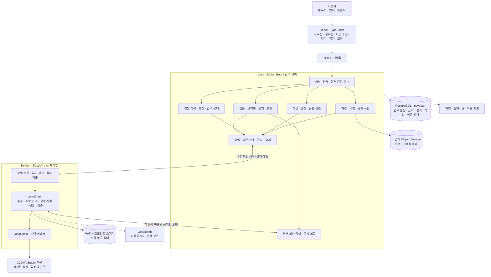
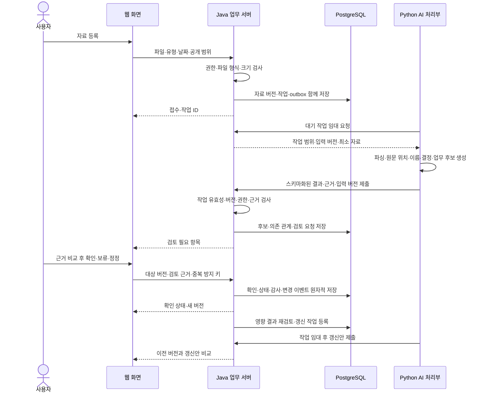
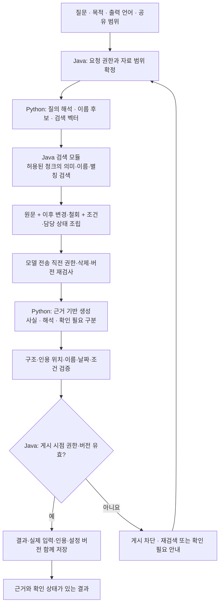
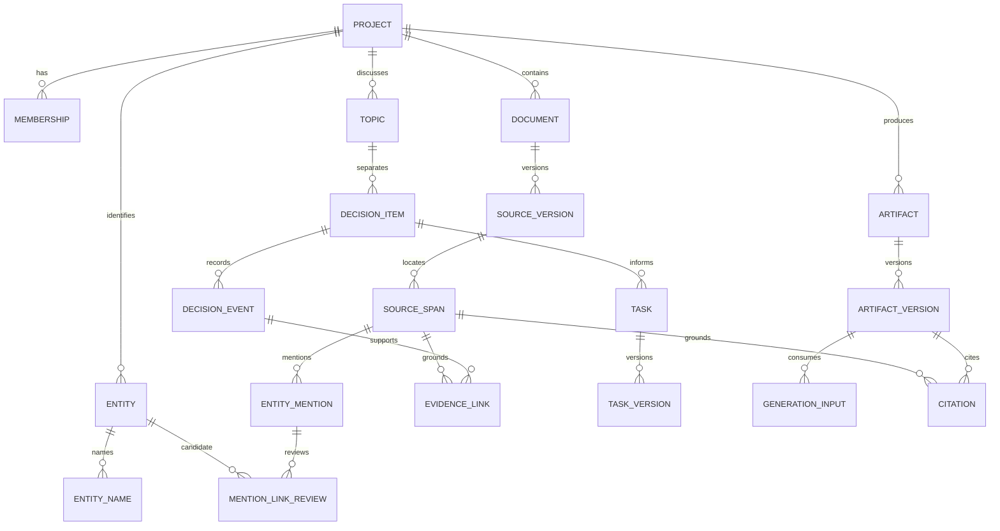

# Contexa 서비스 제안서

> 다국어 회의의 맥락과 근거를 연결하고, 사람·회사·기관의 이름을 확인해 다음 업무로 이어주는 AI 협업 서비스
>
> 작성일: 2026-11-08 · 지원 언어: 한국어·영어·아랍어 · 문서 상태: 개발·검증 계획

## 1. 서비스 설명 및 핵심 기능

### 1.1 서비스 개요

**Contexa는 다국어 회의 전사문과 업무 문서, 규정, 메모를 연결해 현재 결정과 그 근거를 파악하고 후속 업무까지 이어주는 AI 협업 서비스다.** 여러 회의에 흩어진 내용을 프로젝트 단위로 축적하여, 사용자가 “지금 무엇이 결정됐는가”, “왜 바뀌었는가”, “누가 어떤 조건에서 무엇을 해야 하는가”를 확인할 수 있도록 한다.

주요 사용자는 한국인·외국인 구성원이 함께 활동하는 국제교류 행사 준비팀, 다국어 팀 프로젝트 참여자, 신규 합류자와 인수인계 담당자다. 초기 적용 상황은 한국외대 국제교류 행사 준비로 설정하며, 이후 한국 기업과 아랍권 협력사가 함께하는 글로벌 프로젝트에도 적용할 수 있다.

서로 다른 언어가 섞이는 회의에서는 문장의 뜻뿐 아니라 사람·회사·기관의 정확한 이름과 실제 지칭 대상을 확인하는 일이 중요하다. 전사문에 잘못 기록된 이름이 그대로 검색, 담당자 지정, 보고서와 메일에 사용되면 후속 업무에도 오류가 이어진다. Contexa는 **다국어 고유명사 검수, 결정 변경 이력, 정정에 따른 후속 영향 관리**를 하나의 업무 흐름으로 연결한다.

### 1.2 주요 기능

| 핵심 기능 | 서비스 동작 | 사용자 가치 |
| --- | --- | --- |
| 프로젝트 맥락 브리핑 | 여러 회의·문서를 연결해 목표, 현재 결정, 변경 이유, 미해결 사항을 정리한다. | 회의에 빠졌거나 새로 합류한 사람이 업무 흐름을 빠르게 파악한다. |
| 다국어 근거 검색·질의응답 | 한국어·영어·아랍어 질문으로 다른 언어의 자료를 찾고, 답변의 주요 사실을 원문 발언·문단·페이지에 연결한다. | 표현이나 회의 날짜를 정확히 기억하지 못해도 근거를 찾아 확인한다. |
| 고유명사 확인 | 이름 후보를 명단·관련 문서·문맥과 비교하고, 언어별 표기와 실제 인물·기관 연결을 검토한다. 원음이 있으면 대응 구간을 재생한다. | 비슷한 인명, 회사 약칭, 잘못 전사된 이름을 구별한다. |
| 혼합언어 의미 보존 | 한 발언 안에서 언어가 바뀌어도 부정, 조건, 기한, 수치, 업무 범위를 함께 해석한다. | “디자인은 금요일까지, 인쇄는 예산 승인 전 보류”와 같은 조건을 유지한다. |
| 결정 이력·충돌 확인 | 제안·확정·변경·철회를 구분하고, 회의 간 날짜·담당자·금액·조건의 불일치 및 규정과의 충돌을 제시한다. | 최신 발언을 무조건 최종 결정으로 오해하지 않고 확인할 사항을 파악한다. |
| 업무 목록·다음 회의 준비 | 업무, 담당 후보, 기한, 선행 조건을 추출하고 담당자의 수락과 실제 진행 상태를 관리한다. 미해결 안건과 확인 질문을 모은다. | 각자의 할 일과 다음 회의에서 결정할 일을 연결한다. |
| 누적 위키·다국어 초안 | 안건별 배경과 결정 이력을 위키로 축적하고, 같은 확인 정보를 보고서·메일·메시지 초안에 활용한다. | 자료를 다시 찾거나 목적별 문서를 처음부터 작성하는 부담을 줄인다. |
| 정정 영향 추적 | 이름·원문·결정이 바뀌면 관련 업무·위키·답변·초안을 재검토 대상으로 표시하고 변경안을 제공한다. | 이전 오류나 일정이 후속 문서에 남는 문제를 확인하고 수정한다. |

이름 검수에서는 **음성 대조, 언어별 표기 확인, 지칭 대상 연결을 각각 관리**한다. 명단에 이름이 있어도 해당 발언이 그 사람을 지칭한다는 사실까지 자동 확정하지 않는다. 이름 확인, 로그인 계정 연결, 화자 연결, 업무 수락도 구분한다. 근거가 부족하면 미확인 또는 보류로 남기며, 검토자가 근거를 확인한 결과를 저장한다.

### 1.3 대표 사용 흐름

국제교류 행사를 준비하는 팀에 한국어·영어·아랍어 회의 전사문, 참석자 명단, 협력사 소개서, 행사 운영 지침이 쌓여 있다고 가정한다. 회의에 빠졌던 팀원은 자료를 등록한 뒤 다음 흐름으로 업무에 복귀한다.

1. “현재 어디까지 결정됐어?”라고 질문해 온라인 행사 제안에서 대면 개최로 변경된 과정과 근거를 확인한다.
2. 전사문에 나온 ‘아흐마드’와 ‘누르’가 누구인지 후보를 비교하고, 인물·회사 및 사용할 언어별 표기를 확인한다.
3. “인쇄를 진행해도 돼?”라고 질문해 예산 승인 전에는 보류라는 조건을 확인한다.
4. 운영 지침의 사전 승인 조건과 제출일의 충돌을 살펴보고, 담당자별 업무와 미정 항목을 확인한다.
5. 같은 확인 정보를 바탕으로 한국어 보고서, 협력사 영어 메일, 아랍어 공지 초안을 작성한다.
6. 이후 이름 연결이나 일정이 정정되면 영향을 받은 업무·위키·초안을 확인하고 새 버전으로 반영한다.

이는 시연용 가상 상황이며, 실제 학교 규정이나 특정 조직의 도입 사실을 의미하지 않는다.

### 1.4 기존 방식과의 차별점

비교 기준은 개별 전사문 요약, 수동 문서 검색, 일반적인 문서 질의응답을 조합하는 업무 방식이다. 특정 경쟁 제품에 해당 기능이 없다고 전제하지 않고, Contexa가 구현·검증할 처리 방식으로 차별성을 설명한다.

| 비교 관점 | 기존 방식에서 사용자가 추가로 수행하는 일 | Contexa의 설계 방향 |
| --- | --- | --- |
| 회의 간 맥락 | 회의별 요약을 읽고 결정이 언제, 왜 바뀌었는지 다시 비교한다. | 같은 안건의 결정 항목과 변경 이력을 연결하고 현재 유효한 상태를 제시한다. |
| 다국어 이름 | 음역이나 문자열 검색 결과를 보고 실제 인물·기관을 수동으로 추정한다. | 대상별 식별자, 언어별 이름, 별칭, 확인 근거를 연결하고 동명이인·유사 이름을 분리한다. |
| 업무상 확정 | 생성된 문장이 제안인지, 승인된 사실인지 사용자가 다시 확인한다. | AI 후보, 사용자 확인, 조건 충족, 담당 수락, 현재성을 구분해 표시한다. |
| 근거 확인 | 문서명이나 요약만 보고 원문 위치를 다시 찾는다. | 주요 사실을 원문 구간과 버전에 연결하고 규정의 판본·시행일·적용 대상을 함께 제시한다. |
| 오류 정정 | 이름이나 일정이 바뀌면 관련 문서·업무를 찾아 개별 수정한다. | 생성에 사용한 자료와 상태의 의존 관계를 기록해 영향 대상을 찾고 재검토한다. |
| 지식 축적 | 요약·보고서가 별도 문서로 쌓여 최신 상태를 다시 판단해야 한다. | 원문에 연결된 안건별 위키를 갱신하고, 오래된 정보와 확인되지 않은 내용을 구분한다. |

차별화의 중심은 **한 번 생성한 결과의 유창함뿐 아니라, 근거·확인 상태·변경 이력을 후속 업무까지 유지하는 구조**에 있다. 효과는 동일 자료를 사용하는 기본 문서 질의응답 방식과 비교하여 잘못된 이름 연결, 미확정 결정의 오확정, 정정 누락, 사용자 확인 시간을 측정한다.

## 2. 활용 기술 및 플랫폼

### 2.1 AI 도구를 활용한 바이브코딩 계획

**Codex를 개발 보조 도구로 활용하여 자연어 요구사항을 화면·API·데이터 구조·검증 코드로 구체화한다.** 예를 들어 “이름 후보와 근거를 비교하고 확인·보류할 수 있는 화면”, “같은 안건의 결정 변경을 시간순으로 보여주는 기능”을 요구사항과 예시 데이터로 전달하고, 생성된 구현을 팀이 검토·실행·수정하는 방식으로 개발한다. 코드 작성·검토·디버깅 지원은 공식 문서에서 안내하는 활용 범위다. [OpenAI 코드 생성 안내](https://developers.openai.com/api/docs/guides/code-generation)

바이브코딩으로 우선 구현할 기능은 **자료 등록과 원문 보기, 이름 검수 카드, 결정 타임라인, 근거 기반 질문·브리핑, 담당자별 업무, 다국어 초안 및 정정 영향 표시**다. 기능별로 입력 예시·기대 결과·금지되는 상태 변경을 함께 전달하고, 다른 프로젝트 자료 접근, 중복 승인, 잘못된 이름 확정과 같은 실패 사례도 검증한다. 권한·승인·저장 규칙은 서버 코드와 데이터 제약으로 구현하며, AI가 생성한 코드도 사람이 확인한 뒤 반영한다.

### 2.2 서비스 구현 기술

| 구분 | 활용 기술·플랫폼 | 적용할 기능 |
| --- | --- | --- |
| 웹 화면 | React·TypeScript | 자료함, 원문·번역 병기, 이름 검수, 결정 타임라인, 업무·위키·초안 화면. 아랍어와 혼합문자 표시 지원 |
| 업무 서버 | Java·Spring Boot | 인증·프로젝트 권한, 자료 버전, 이름·결정 검토, 담당 수락, 상태 전이, 감사 기록, 내보내기·삭제 |
| AI 처리부 | Python·FastAPI | 문서 추출, 혼합언어 해석, 고유명사·결정·업무 후보 생성, 근거 조립, 답변·초안 생성 |
| 모델·도구 연결 | LangChain | 생성 모델·임베딩·검색 인터페이스 연결. 모델 제공업체 변경에 대비한 어댑터 구성 |
| 처리 흐름 | LangGraph | 추출→검증→검토 대기→재개 및 검색→생성→근거 검증의 단계 제어와 작업 복구 |
| 생성 모델 | NAVER Cloud CLOVA Studio 우선 검토 | 구조화된 후보 추출, 질의응답, 브리핑·초안 생성. 세 언어 품질 평가를 통과한 모델 경로만 적용 |
| 지식 축적 | LLM 기반 누적 위키 | 확인된 결정과 원문을 바탕으로 안건별 페이지 갱신안 생성. 위키 버전·근거·재검토 상태 관리 |
| 데이터·검색 | PostgreSQL·pgvector | 업무 데이터와 근거·버전 저장, 다국어 임베딩 검색 및 이름·별칭 검색 결합 |
| 파일·배포 | NAVER Cloud 비공개 Object Storage·애플리케이션 서버·Cloud DB for PostgreSQL 검토 | 원본 파일 보관, 웹·Java·Python 실행, 데이터 저장과 백업 |
| 평가·운영 | LangSmith 및 서버 운영 지표 | 언어별 평가, 프롬프트·모델 변경 비교, 지연·오류·호출량 추적 |

LangChain은 모델·도구 연결, LangGraph는 처리 상태와 중단·재개, LangSmith는 평가·추적을 맡는다. **결정·승인·업무의 최종 기록은 Java 업무 서버와 PostgreSQL에서 관리**하며, 그래프의 실행 상태나 추적 로그를 최종 업무 기록으로 사용하지 않는다. LLM 위키는 특정 제품 이름이 아니라 본 서비스의 지식 축적 방식이다. [LangChain](https://docs.langchain.com/oss/python/langchain/overview), [LangGraph 상태 저장](https://docs.langchain.com/oss/python/langgraph/persistence), [LangSmith 평가](https://docs.langchain.com/langsmith/evaluation)

### 2.3 모델 적용과 범위

CLOVA Studio의 구조화 출력 API와 Python LangChain 연동을 활용하는 방향으로 설계한다. 확인한 공식 문서상 Structured Outputs는 HCX-007을 대상으로 안내하므로 해당 경로의 모델·API·스키마 호환성을 실호출로 확인한다. **구조화된 형식을 반환한다는 사실이 아랍어 의미·이름의 정확성을 보장하지는 않는다.** 한국어·영어·아랍어·혼합언어 평가를 먼저 수행하고, 품질이 부족한 경로는 처리 조건이 확인된 대체 다국어 모델을 같은 인터페이스에 연결하여 재평가한다. 적합한 경로를 확보하지 못하면 해당 언어의 구현 미완료로 기록하며 지원 완료로 표시하지 않는다. [구조화 출력](https://api.ncloud-docs.com/docs/clovastudio-chatcompletionsv3-so), [NAVER Cloud LangChain 연동](https://guide.ncloud-docs.com/docs/clovastudio-dev-langchain)

검색은 다국어 임베딩과 확인된 이름·별칭 검색을 결합한다. 임베딩 모델·차원·전처리 버전을 기록하고, 다른 모델의 벡터는 동일 인덱스에서 섞어 비교하지 않는다. pgvector와 관리형 PostgreSQL의 실제 확장 버전·설치 조건은 배포 환경에서 확인한다. [pgvector 공식 문서](https://github.com/pgvector/pgvector), [Cloud DB 확장 관리](https://guide.ncloud-docs.com/docs/clouddbforpostgresql-postgresqlextension)

초기 입력은 전사문 붙여넣기와 TXT·MD·텍스트 PDF·DOCX·SRT·VTT이며, 원본 녹음은 기존 전사문의 대응 시각이 있을 때 선택적으로 재생한다. 녹음 자동 전사, 이름 구간 자동 재인식, 스캔 문서 OCR, 외부 서비스 자동 동기화, 메일·메시지 실제 발송은 후속 확장으로 둔다.

## 3. 서비스 개발 계획

### 3.1 본선 진출 시 구현할 결과물

### 3.2 개발 추진 계획

기존 기획의 **3주 개발 기간을 가정한 계획**이다. 실제 착수일과 일정은 본선 안내에 맞춰 조정한다. 팀 인원·투입 시간은 아직 확정된 정보가 없으므로 아래 일정은 역할별 작업 분담과 초기 모델 품질 검증이 가능하다는 전제의 계획이며, 전체 요구사항의 구현 완료를 미리 보장하지 않는다.

| 단계 | 주요 개발 내용 | 점검 기준 |
| --- | --- | --- |
| 착수·1~2일 | 세 언어 표본과 정답 마련, 모델·임베딩 실호출, 화면 흐름·DB·API·상태 규칙 합의, 개발·시험 환경 구성 | 아랍어·혼합언어의 이름·조건 추출과 교차 검색 가능성 확인. 실패 항목과 대응 경로 기록 |
| 1주차 | 인증·프로젝트 권한, 자료 등록·원문 위치·버전 저장, 비동기 분석, 고유명사 후보와 검수 화면, 결정·업무 후보의 기본 저장 | 자료→근거 있는 후보→사용자 확인→저장 흐름 연결. 다른 프로젝트·개인 자료의 접근 차단 |
| 2주차 | 결정 변경·조건·충돌 관리, 담당 수락·진행 상태, 교차 언어 검색, 브리핑·규정 대조, 누적 위키·초안, 정정 영향 및 검토함 연결 | 대표 복귀 시나리오를 세 언어로 수행. 이름·일정 정정이 관련 결과의 재검토로 이어지는지 확인 |
| 3주차 전반 | 고정 평가, 동시 수정·재시도·권한 회수·삭제 시험, 아랍어 표시·복사·내보내기 검증, 사용자 확인 부담 측정 | 요구사항의 품질 기준과 필수 예외 시험 비교. 오류 수정 및 회귀 확인 |
| 3주차 후반 | 배포 설정 정리, 백업 복원·장애 대응·비용 한도 확인, 시연 흐름 점검, 구현 상태와 미완료 항목 정리 | 정상·실패 경로 재현, 자료·프롬프트·모델·배포 버전 고정 |

첫 주부터 자료 등록, 이름 검토, 상태 저장을 화면과 서버에 연결한다. 두 번째 주 말부터는 기능 추가보다 정확성·권한·정정 처리의 결함 수정에 집중한다. 일정이 부족하면 화면 장식과 후속 확장을 먼저 줄이고, 필수 기능의 미완료 여부를 명시한다. 한국어·영어·아랍어 지원과 근거·검토 상태 구분을 완료된 것처럼 축소 보고하지 않는다.

### 3.3 팀 내 역할 분담

팀원 이름·인원은 확정 후 배정하며, 현재는 네 가지 책임 영역으로 나눈다. 한 사람이 여러 역할을 맡을 수 있으나 아랍어 정답 검토와 실제 운영 책임자는 별도로 지정한다.

| 역할 | 주요 책임 | 협업·검토 사항 |
| --- | --- | --- |
| 기획·데이터·품질 | 사용자 흐름, 요구사항 관리, 합성 자료·정답 제작, 언어 검수, 비교 평가, 발표 구성 | 아랍어 검토 가능 인력 확보. AI 출력과 독립된 정답 관리 |
| 프론트엔드·UX | 자료함, 원문 보기, 이름 비교 카드, 타임라인·업무·위키·초안, 아랍어 표시와 접근성 | 미확인·보류·재검토를 사용자가 구분하고 다음 행동을 할 수 있는지 확인 |
| 백엔드·데이터·운영 | Java API, 인증·권한, 데이터 구조·버전·트랜잭션, 작업 관리, 감사·삭제·배포·백업 | Python 결과를 저장하기 전 권한·근거·버전 검사. 장애·비용 운영 책임 |
| AI·검색 | Python 처리부, LangChain·LangGraph, 추출·검색·생성, 이름 후보 비교, LangSmith 평가 | 정답 없는 경우의 보류, 언어별 성능, 근거 누락·의미 왜곡 개선 |

기능별 담당자는 바이브코딩 도구로 구현 초안을 만들고 다른 역할 담당자와 API·상태·사용자 경험을 함께 검토한다. 공통 데이터 계약을 먼저 정해 화면·서버·AI가 서로 다른 의미의 ‘확정’을 사용하지 않도록 한다.

### 3.4 필요한 데이터·자료

| 필요한 자료 | 활용 목적 | 확보·작성 계획 |
| --- | --- | --- |
| 연속된 다국어 회의 전사문 | 맥락, 부분 변경, 보류 조건, 충돌·담당 추출 검증 | 국제교류 행사 시나리오를 바탕으로 3~5회 연속 회의 묶음 제작. 초기에는 합성 자료 사용 |
| 참석자·협력사 명단 | 이름 후보, 언어별 표기, 동일 대상 연결 검증 | 가상 인물·기관에 식별자를 부여하고 유사 이름·동명이인·약칭·미등록 대상을 포함 |
| 기획서·규정·메모 | 회의와 문서의 충돌, 시행일·판본·적용 대상 비교 | 공개 자료 또는 시연용 가상 자료를 구분해 등록하고 출처·기준일 보존 |
| 선택적 원음·대응 시각 | 음성 대조와 원음 없음 상태 검증 | 사용 가능한 녹음만 연결. 음성 자료 없이도 핵심 검수 흐름을 시험 |
| 독립된 정답·평가 사례 | 추출·검색·인용·이름 연결·보류의 정확도 측정 | 한국어·영어·아랍어·혼합언어 각 집단에 질의·업무 사례 30개 이상, 이름 언급 50개 이상 구성 |
| 사용자 검토 기록 | 확인 시간, 재확인 횟수, 정정 부담 평가 | 언어 검토 가능 참여자에게 합성 자료를 제공해 관찰. 실제 모집·참여는 별도 확보 |
| 권한·장애·변경 시험 자료 | 자료 격리, 권한 회수, 동시 승인, 취소·삭제·복구 검증 | 역할·프로젝트·자료 공개 범위를 조합한 계정과 실패 조건 준비 |

현재 확인한 자료는 요구사항 명세서, 서비스 시나리오, 이전 기획 문서와 대화 기록이다. 실제 사용자 회의 자료, 언어 검수 인력, 모델 호출 결과, 성능 측정 결과는 확보 완료로 간주하지 않는다. 실제 자료를 사용하는 단계에서는 제공 범위·보관·외부 모델 전송 조건을 정하고, 개발용 합성 자료와 분리한다.

### 3.5 예상되는 어려움과 대응

| 예상 어려움 | 대응 계획 |
| --- | --- |
| 아랍어·혼합언어에서 이름과 조건을 잘못 해석 | 세 언어와 혼합언어를 별도 평가하고 원문·번역을 함께 표시한다. 이름 표기와 대상 연결을 사람의 근거 검토로 확인한다. 불명확한 방언·생략은 확인 질문으로 남긴다. |
| 같은 이름을 다른 사람·기관과 혼동 | 이름 문자열과 대상 식별자를 분리한다. 명단·소속·역할·문맥을 함께 비교하고 자동 병합을 막는다. |
| 제안·조건부 합의를 확정 결정으로 처리 | 발언 유형, 사용자 검토, 조건 충족, 현재성을 별도 상태로 관리한다. 최종 상태 변경은 Java 서버 규칙으로 제한한다. |
| 정정 후 기존 초안·위키에 오류가 남음 | 실제 생성 입력과 상태 버전의 의존 관계를 기록한다. 변경 즉시 오래된 결과의 재사용을 막고 영향 목록과 갱신안을 제공한다. |
| 개인 자료가 공용 답변·외부용 초안에 섞임 | 검색, 생성 입력, 결과 제공, 내보내기 단계에서 권한을 검사한다. 외부용 초안은 공유 허용 자료만으로 새로 생성한다. |
| 모델 지연·비용 증가·장애 | 비동기 처리, 호출 한도, 제한된 재시도, 입력 크기 통제를 적용한다. 생성 장애 중에도 기존 자료 조회와 사용자 검토를 유지한다. |
| 3주 내 기능 통합과 검증 부담 | 첫 주에 핵심 흐름을 연결하고 공통 스키마를 고정한다. 외부 연동·자동 전사는 후속으로 유지하며 미완료 범위를 기록한다. |
| 바이브코딩 결과의 구조 불일치·결함 | 요구사항 ID와 입력·기대 결과를 함께 전달한다. 코드 변경을 작게 나누고 권한·상태 전이·정정·복구 시험을 통과한 변경만 반영한다. |

### 3.6 검증 기준

아래 수치는 요구사항 명세서의 **수용 목표**이며 실측 성과가 아니다. 언어별 지표, 표본 수, 실패 사례를 함께 보고한다.

| 검증 항목 | 목표·방법 |
| --- | --- |
| 교차 언어 검색 | 세 언어 질문×자료의 9개 조합을 포함. 정답 있는 질의의 상위 5개 검색 결과 내 정답 근거 포함률 90% 이상 |
| 근거·의미 보존 | 인용 정확성과 주요 사실의 적절한 인용 제공률 각각 95% 이상. 부정·조건·담당·날짜·수치·범위 일치율 95% 이상 |
| 고유명사 | 탐지 정밀도·재현율 각각 90% 이상, 정답 대상이 있는 사례의 상위 5개 후보 포함률 95% 이상 |
| 검수 후 정확성 | 확정 표기·대상 연결 각각 98% 이상. AI 후보 단계와 구분하고 확정·보류 비율, 검토 시간도 함께 보고 |
| 보류 | 판단 불가 사례의 적절한 보류 95% 이상, 답변 가능 사례의 불필요한 보류 10% 이하 |
| 필수 예외 | 권한 밖 노출, 근거·확인자 없는 확정, 이름 자동 병합·업무 자동 수락, 저장된 의존 관계의 재검토 누락은 시험에서 0건 |
| 성능 | 일반 조회·저장 p95 2초, 근거 검색 p95 5초, 일반 생성 p95 60초 이내. 10MB·추출 10만 자 이하 단일 문서의 95%는 업로드 후 120초 이내 검토 가능 상태 |
| 사용자 효과 | 동일 자료·질문을 사용한 기본 문서 질의응답과 비교하여 잘못된 연결·오확정·정정 누락과 확인 시간을 측정 |

성능 시험은 프로젝트당 문서 100개·추출 텍스트 100만 자, 동시 활성 사용자 10명, 일반 생성 입력 문맥 2만 자·출력 3천 자 이하를 기본 조건으로 한다. 일반 요청을 100회 이상 측정하고 네트워크·모델 응답 및 시간 초과를 포함한다. 비율 목표는 한국어·영어·아랍어·혼합언어 집단별로 확인한다. 필수 예외 시험 통과는 실제 모든 상황에서의 무오류 보장을 뜻하지 않는다.

---

## 부록 A. 개발용 상세 아키텍처

### A.1 설계 방향과 기존 구조 보완

기존 대화에서 합의한 **웹 화면 → Java 업무 서버 → Python AI 처리부 → PostgreSQL·pgvector·비공개 파일 저장소** 구조를 유지한다. Java 내부는 책임별 모듈로 구성하고 Python은 별도 처리 프로세스로 배포한다. 초기부터 기능별 마이크로서비스나 별도 그래프 DB를 도입하지 않는다.

| 기존 구조의 핵심 | 이번 보완 내용 |
| --- | --- |
| Java의 권한·승인·업무 상태 책임 | 확정 API, 버전 충돌, 중복 요청 방지, 감사·변경 이벤트의 원자적 저장 규칙 명시 |
| Python의 분석·검색·생성 | 분석 후보만 제출하며 업무 확정 테이블을 직접 수정하지 못하도록 접근 경계 명시 |
| 고유명사 검수 | 대상·언어별 표기·원문 언급·연결 검토·음성 대조·업무 수락을 분리 |
| 결정 변경 추적 | 날짜·장소·예산을 독립 결정 항목으로 분리하고 검토·조건·현재성을 별도 관리 |
| 누적 위키·정정 전파 | 원문뿐 아니라 이름 확인·결정·업무 상태 버전을 실제 생성 입력으로 추적 |
| 권한·버전 재검사 | 생성 중 권한 회수, 삭제, 정정 발생 시 결과 게시 차단 및 재생성 경로 추가 |
| 처리 복구 | 영속 작업 큐, 임대·재시도·중복 방지, 취소 후 늦은 결과 차단 규칙 추가 |

### A.2 전체 구성도

외부에서 접근하는 서비스 API는 Java로 통일한다. Python은 작업용 서비스 자격으로 내부 API만 호출하며 사용자 세션·범용 DB 쓰기 권한을 받지 않는다. 원본 파일은 Java가 권한을 검사해 중계하고, Object Storage의 영구 공개 주소를 제공하지 않는다. 모델 API 키는 서버의 비밀 설정으로 관리한다.

### A.3 모듈별 책임과 인터페이스

| 모듈 | 책임·주요 입력 | 출력·소유 데이터 | 경계 |
| --- | --- | --- | --- |
| `identity-access` | 인증, 멤버 역할, 자료 열람·편집·공유 정책 | 사용자·멤버십·자료 ACL·정책 버전 | 클라이언트가 보낸 역할이나 프로젝트 ID만으로 허용하지 않음 |
| `document-evidence` | 파일 검사, 원본 버전, 파싱 결과 검증, 원문 위치 | 문서·버전·원문 구간·청크 | 업로드 시각과 실제 회의·문서 기준일을 분리 |
| `entity-review` | 이름 언급, 후보 비교, 언어별 표기·대상 연결 검토 | 대상·별칭·확인 기록·철회 기록 | 유사 문자열 자동 병합과 계정 자동 연결 금지 |
| `decision-task` | 안건·결정 항목·조건, 업무 담당·수락·진행 | 결정 사건·현재 상태·업무 버전 | AI 제안을 자동 승인·배정·완료 처리하지 않음 |
| `retrieval` | 질의 벡터·별칭·필터, 요청자·작업 범위 | 허용된 원문 근거·관련 상태 버전 | 위키만으로 사실을 확정하지 않음 |
| `generation-wiki` | 목적·언어·허용 근거, 후보 응답 | 답변·브리핑·위키·초안 버전 | 실제 사용 입력과 인용을 모두 저장 |
| `review-impact` | 검토 요청, 원문·이름·결정·권한 변경 | 검토함·의존 관계·재검토 목록·알림 | 원문 정정이 기존 승인 기록을 덮어쓰지 않음 |
| `job-operation` | 작업 생성·임대·취소·결과, 비용 정책 | 작업·시도·outbox·감사·삭제 상태 | 중복 제출과 취소·삭제 후 결과 게시 차단 |
| `ai-pipeline` | 작업에 허용된 원문·검색 결과·설정 버전 | 파싱·이름·결정·업무 후보, 생성안·근거 목록 | 업무 원장 직접 수정 불가 |

### A.4 자료 등록·검토·정정 흐름

원본 파일과 정정본은 각각 보관한다. 원문 위치는 실제 존재하는 페이지·문단·발언·시간 구간만 사용하며 DOCX의 고정 페이지처럼 안정적으로 확보할 수 없는 위치는 문단 식별자로 연결한다. 추출한 문장은 `source_version_id`와 `span_id`를 가지며, 이름 정정은 선택한 언급에만 적용한다.

사용자 검토는 Java DB에 저장된 검토 요청을 기준으로 처리한다. LangGraph의 중단·재개는 실행 편의를 위한 수단으로만 사용하며, 재개 시 서버가 현재 버전과 권한을 재확인한다. 중단 지점이 포함된 노드는 재개 시 다시 실행될 수 있으므로 승인 저장 같은 부작용은 별도 서버 API와 중복 방지 키로 보호한다. [LangGraph 중단·재개](https://docs.langchain.com/oss/python/langgraph/interrupts)

### A.5 질문·브리핑·초안 생성 흐름

재검색은 설정한 횟수·시간 한도 안에서만 수행한다. 근거가 부족하거나 상충하면 확인 불가·추가 확인 필요를 응답한다. 후보 식별자와 원문 위치는 서버가 존재 여부를 검사하고, 인용이 실제 주장을 뒷받침하는지는 평가와 검토를 병행한다. 형식 검증 통과만으로 의미 정확성을 보장하지 않는다.

검색 범위는 모델이 정하지 않고 서버가 제한한다. 작은 초기 데이터셋에서는 권한으로 제한한 자료에 정확 벡터 검색을 적용하고, 근사 인덱스를 도입할 때는 제한된 자료 안에서의 근거 누락을 다시 측정한다. 한국어·아랍어 원문을 단순 공백 분리한 검색에 의존하지 않고 다국어 임베딩, 확인된 대상·별칭, 언어별 검색용 정규화 필드를 조합한다. 원문과 공식 표기는 정규화 결과로 덮어쓰지 않는다.

외부용 초안은 외부 공유 가능한 근거만으로 생성한다. 내부 결과에서 인용 표시만 지워 외부용으로 바꾸지 않는다. 공용 위키에는 프로젝트 공용 자료만 사용하고 개인 자료가 포함된 브리핑은 해당 권한 범위에서만 제공한다.

### A.6 데이터 구조

업무 상태는 관계형 데이터로 관리하고, 긴 문서 원본은 파일 저장소에 둔다. 검색 벡터와 위키는 원본에서 재구성할 수 있는 파생 자료다. 모든 프로젝트 데이터는 `workspace_id`, `project_id`를 포함하며 연관 데이터가 같은 프로젝트에 속하는지 서버 검사와 복합 참조 제약으로 검증한다.

ERD는 핵심 관계만 나타낸다. 업무의 결정 항목 연결은 선택 사항이며, 한 업무가 여러 결정에 의존하면 아래 의존 관계 테이블로 추가 연결한다. 실제 마이그레이션에서는 다음 테이블과 필드를 정의한다.

| 영역·주요 테이블 | 핵심 필드·제약 |
| --- | --- |
| `user`, `workspace`, `project`, `membership`, `document_acl` | 역할은 조회자·편집자·검토자·관리자. 열람·편집·공유 권한 분리. `membership`은 프로젝트·사용자 조합 유일 |
| `document`, `source_version` | 자료 유형, 언어, 회의 시각·시간대, 문서 기준일·규정 판본·시행일·적용 대상, 업로드 시각, 객체 키·내용 해시, 삭제 상태. 문서·버전 번호 유일 |
| `source_span`, `chunk`, `chunk_span`, `chunk_embedding` | 원문·페이지·문단·발언·시간 정보, 청크와 원문 위치 매핑. 임베딩 모델·차원·전처리 버전 저장. 날짜·위치 미확인은 null과 사유로 보존 |
| `entity`, `entity_name`, `entity_mention` | 사람·회사·기관 구분, 언어별 원표기·제안 표기·확인 표기, 별칭·검색용 정규화, 원문 속 언급과 적용 구간. 이름 문자열에 전역 유일 제약을 두지 않음 |
| `name_verification`, `mention_link_review`, `audio_review` | 확인 언어·대상·원문 버전·상태·검토자·시각·근거 또는 명시적 확인 진술. 음성 대조와 대상 연결의 상태 분리. 철회는 새 기록 |
| `entity_account_link`, `speaker_link` | 인물과 로그인 계정, 인물과 전사 화자의 연결을 각각 별도 검토. 이름 확인만으로 생성하지 않음 |
| `topic`, `decision_item`, `decision_event`, `decision_projection` | 안건, 날짜·장소·예산 등 결정 항목, 발언 유형·검토 상태·조건 상태, 실제 발생 시점과 기록 시점, 대체할 사건 ID, 현재 상태 버전 |
| `condition`, `condition_evidence`, `task`, `task_version`, `assignment_acceptance` | 업무 내용·담당 후보·기한·산출물·선행 조건·진행 상태. 담당 수락은 인증된 당사자의 별도 기록. 미정 기한·담당 허용 |
| `artifact`, `artifact_version`, `generation_run`, `generation_input`, `citation` | 답변·브리핑·위키·초안과 버전·공개 범위. 실제 입력의 자료·이름·결정·업무 버전, 모델·프롬프트·검색 설정, 생성 시각·인용 위치 |
| `resource_revision`, `dependency` | 원문·이름 확인·결정·업무·결과 버전의 공통 참조 등록. `from_revision_id`, `to_revision_id`, 사용 목적을 외래키로 연결. 의존 관계는 같은 프로젝트로 제한 |
| `review_request`, `review_action`, `in_app_notification` | 검토 대상·버전·종류·상태·행위자·시각. 알림도 대상 접근권한 검사. 만료된 대상 버전의 확인 거절 |
| `job`, `job_attempt`, `outbox`, `idempotency_record`, `audit_event`, `deletion_job` | 임대·재시도·입력 버전·취소·결과, 이벤트 ID·처리 상태, 중복 방지 키와 요청 해시, 감사·삭제 진행 |

`resource_revision`에는 실제 소유 테이블과 일치하는 참조를 트랜잭션 안에서 등록한다. 일반적인 문자열 ID만 저장해 존재하지 않는 대상을 참조하는 구조를 피한다. 원문·결정·확인 기록은 이력을 보존하고, 현재 표시용 `decision_projection`은 사건 기록에서 재구성한다. 삭제 시에는 보관 정책을 우선 적용하며 감사 기록에 삭제된 원문을 복제해 남기지 않는다.

### A.7 상태 전이와 업무 규칙

| 대상 | 상태·전이 | 허용 주체·핵심 규칙 |
| --- | --- | --- |
| 처리 작업 | 등록→대기→분석 중→검토 필요/완료/실패. 취소 요청 후 취소. 실패 재시도는 새 시도 기록 | 처리 완료와 내용의 업무상 확정을 구분. 취소된 작업의 늦은 응답은 게시하지 않음 |
| 이름 표기 | 제안/미확인→확인 완료/보류/거절. 정정·취소는 새 검토 버전 | 검토 권한 필요. 한 언어 확인이 다른 언어 확인으로 확대되지 않음 |
| 대상 연결 | 후보→연결 확인/보류/고유명사 아님. 잘못된 연결은 철회 후 재검토 | 적용 언급을 명시. 이름 유사성만으로 자동 병합하지 않음 |
| 음성 대조 | 원음 없음/미대조/대조 완료 | 대응 원음과 검토 기록이 있을 때만 대조 완료 |
| 결정 | 발언 유형: 제안·논의·보류·확정 주장·변경·철회 / 검토: 대기·확인·보류·거절 / 조건: 미확인·미충족·충족 / 현재성: 미확정·유효·대체·철회·충돌 | 각 축을 별도 저장. 최신 업로드·최신 제안만으로 기존 결정을 대체하지 않음 |
| 업무 | 추출·검토 상태 / 담당 수락 대기·수락·거절 / 예정·진행 중·보류·완료·취소 | 각 축을 별도 저장. AI가 당사자의 수락이나 실제 완료를 대신 기록하지 않음 |
| 생성 결과 | 생성 중→검토 가능→저장. 입력 정정 시 재검토 필요→갱신안→사용자 확인 후 새 버전 | 편집된 초안을 자동 덮어쓰지 않음. 삭제·권한 회수는 단순 경고가 아닌 접근 제한 |

현재 결정은 같은 결정 항목 안에서 검토 완료된 사건과 명시적 대체·철회 관계로 계산한다. 발생 시점이 없거나 승인된 사건들이 충돌하면 현재성 판단을 보류한다. 예산 조건의 충족은 날짜·장소의 확정 여부와 독립적으로 관리한다. 상태 규칙을 수정할 때 버전을 부여하고 기존 사례에 대한 회귀 시험을 수행한다.

### A.8 주요 API 계약

공개 API 기본 경로는 `/api/v1/projects/{projectId}`다. 아래 표는 그 뒤의 경로이며, 모든 요청에서 로그인 사용자와 현재 프로젝트·자료 권한을 검사한다. API 세부 요청·응답은 구현 시 OpenAPI로 고정한다.

| 메서드·경로 | 역할 | 주요 계약 |
| --- | --- | --- |
| `POST /documents` | 텍스트·파일 등록 | 자료 유형·언어·날짜·공개 범위. `202`와 `documentId`, `sourceVersionId`, `jobId` 반환 |
| `GET /jobs/{jobId}` | 작업 상태 조회 | 단계·재시도 가능 여부·사용자용 오류·검토 요청 ID 반환 |
| `POST /jobs/{jobId}/cancel` | 대기·진행 작업 취소 | 취소 의사를 저장하고 게시 차단. 이미 완료된 결과의 삭제와는 구분 |
| `GET /sources/{versionId}/spans/{spanId}` | 인용 원문 조회 | 해당 판본의 위치·원문 반환. 삭제·권한 회수 시 차단 |
| `POST /documents/{documentId}/revisions` | 원문·화자 정정 | 기준 버전과 변경 구간. 새 버전·영향 작업 반환 |
| `POST /reviews/{reviewId}/actions` | 이름·결정·충돌 확인·보류·정정 | 검토 종류, 행위, 기준 버전, 근거, 선택 언급 ID. 언어별 이름 확인과 대상 연결의 별도 요청 지원 |
| `POST /tasks/{taskId}/acceptance` | 담당 수락·거절 | 인증된 당사자·기준 버전·의사. 계정 연결 검증 |
| `PATCH /tasks/{taskId}/status` | 진행 상태 변경 | 담당자 또는 허용 역할, 기준 버전, 상태·변경 이유 |
| `POST /generations` | 질의·브리핑·위키·초안 생성 | 종류, 질문·목적, 언어, 자료 필터, 내부/외부 용도. `202`와 작업 ID |
| `GET /artifacts/{artifactId}` | 생성 결과 조회 | 버전, 기준 시각, 확인·재검토 상태, 인용, 허용된 원문 링크 |
| `POST /artifacts/{artifactId}/revisions` | 편집·갱신안 적용 | 기준 버전·내용·적용 대상. 새 버전 반환 및 변경 사실의 근거 재검토 |
| `GET /impacts` | 정정 영향 조회 | 변경 버전별 관련 업무·위키·초안과 갱신 상태 |
| `POST /exports` | MD·TXT·JSON 내보내기 | 범위·형식·용도. 현재 접근·외부 공유 가능 여부 재검사 |
| `DELETE /documents/{documentId}` | 자료 삭제 요청 | 즉시 접근 차단 후 `202`와 삭제 작업 ID. 완료·실패 별도 조회 |

멤버 초대·역할 변경·제외, 자료 ACL 변경, 프로젝트 삭제와 계정 탈퇴 API도 같은 정책을 적용한다. 초대 대상 계정을 이름 후보만으로 선택하지 않는다.

상태 변경은 `expectedVersion`과 `Idempotency-Key`를 요구한다. 같은 키·같은 요청은 기존 결과를 반환하고, 같은 키·다른 본문 및 오래된 버전은 `409`로 거절한다. 미인증은 `401`, 허용되지 않은 작업은 `403`, 존재 여부를 숨겨야 하는 자원 조회는 `404`, 입력 오류는 `422`, 사용 한도 초과는 `429`로 구분한다.

Java와 Python 사이의 내부 API는 `/internal/v1/jobs/claim`, `/jobs/{id}/heartbeat`, `/jobs/{id}/result`, `/jobs/{id}/fail`, `/jobs/{id}/evidence`로 분리한다. 결과 제출에는 `jobId`, `attemptId`, 임대 토큰, 입력 버전 목록, 설정 버전, 실제 사용 근거, 구조화된 결과가 필요하다. 서버는 작업에 기록된 요청자·프로젝트·자료 범위로 검사하며 Python이 보낸 사용자 ID를 권한 근거로 신뢰하지 않는다.

### A.9 작업 복구·동시 수정·정정 전파

초기에는 PostgreSQL의 영속 작업 테이블을 사용한다. Java가 대기 작업을 원자적으로 임대하고 Python은 주기적으로 임대를 갱신한다. 처리기 중단으로 임대가 만료되면 마지막 유효 단계에서 재시도한다. 모델 호출은 시간 상한과 제한된 재시도를 두며, 입력 오류·권한 철회·취소·삭제는 자동 재시도하지 않는다.

확정 기록, 상태 변경, 감사 기록, `outbox` 이벤트는 하나의 DB 트랜잭션으로 저장한다. 이벤트 전달은 중복될 수 있다고 가정하고 `event_id` 및 작업 중복 방지 키로 소비 결과를 한 번만 적용한다. 이 방식은 서비스 상태의 중복 반영을 막는 것이며, 제공업체 응답 유실 시 모델 호출 비용까지 정확히 한 번만 발생한다고 보장하지 않는다.

정정 전파는 다음 순서를 따른다.

1. 원문·이름·결정의 새 버전을 저장하면서 프로젝트의 내용 변경 번호를 증가시키고 변경 이벤트를 남긴다.
2. 생성 결과에는 사용 당시 내용·권한 버전과 실제 입력 목록을 저장한다. 변경 번호가 다르면 의존 관계 재검증 전까지 최신 확인 결과로 제공하거나 재사용하지 않는다.
3. 작업자가 `dependency`를 따라 직접·간접 영향 결과를 찾아 재검토 상태로 전환하고, 권한이 있는 사용자에게 서비스 내 알림을 제공한다.
4. 새 입력으로 생성한 갱신안을 이전 버전과 비교한다. 사용자 편집·기존 확인 기록은 보존하고 검토 후 새 버전을 저장한다.
5. 관계가 없음을 확인한 결과는 검증 번호만 갱신한다. 갱신 실패 결과는 재검토 상태를 유지한다.

이 중 2단계는 영향 전파 작업이 지연되는 동안 이전 정보가 최신처럼 노출되는 것을 막는 장치다. 삭제·권한 변경은 조회·검색·내보내기 경로에서 즉시 검사하며 비동기 전파 완료를 기다리지 않는다. 서비스 밖에 이미 복사하거나 내려받은 파일은 자동 수정·회수할 수 없으므로 영향 범위에서 구분한다.

### A.10 배포·보안·운영

웹 정적 파일과 HTTPS 진입점, Java API, Python 처리기를 구분하고 데이터베이스와 처리기 내부 API는 공개망에 노출하지 않는다. 개발·시험·운영의 데이터와 비밀키를 분리한다. 초기 배포는 컨테이너 기반으로 시작하며, 처리량이 늘면 Java 조회 처리와 Python 작업 수를 독립적으로 조정한다.

| 운영 항목 | 적용할 설계 |
| --- | --- |
| 입력 보호 | 파일 크기·실제 형식·추출 길이·압축 해제량 검사, 파서 실행 시간·자원 제한. 문서 속 명령문은 분석 자료로만 취급 |
| 접근 통제 | 서버 권한 검사를 검색 전·생성 입력 직전·결과 제공·원문·내보내기에 적용. Python의 서비스 권한을 작업 범위로 제한 |
| 데이터 보호 | 전송·저장 암호화, 비공개 파일 저장소, 비밀키 분리. 모델에는 허용된 최소 자료만 전송 |
| 로그·추적 | 요청·작업 ID, 단계·지연·오류·모델·사용량을 수집. 원문·이름·토큰을 기본 로그에서 제외 |
| 삭제 | 요청 즉시 접근 차단. 운영 저장소·벡터·캐시·작업·체크포인트 및 파생 자료를 24시간 이내 삭제하거나 제한 후 재생성. 실패를 완료로 표시하지 않음 |
| 백업 | 백업 최대 30일 만료, 복구 시 삭제 기록 우선 적용. RPO 24시간·RTO 4시간을 목표로 실제 복원 시험 |
| 장애 | 모델 장애 시 기존 조회·사용자 검토 유지. 작업 재시도·취소, 실패 원인·복구 방법 표시 |
| 비용 | 프로젝트별 호출·입출력 크기·동시 작업·비용 상한. 한도 도달 시 생성만 대기·차단하고 조회·검토는 유지 |
| 배포 변경 | DB 마이그레이션·API 계약·모델·프롬프트·검색 설정 버전 관리. 변경 전 회귀 평가, 이전 실행 버전으로 복원할 절차 준비 |

LangSmith에는 합성 자료 중심으로 상세 추적을 적용하고, 실제 자료는 입력·출력 숨김과 메타데이터 마스킹을 기본으로 한다. 오류 메시지나 다른 계측 경로에서 원문이 전송되지 않는지도 확인한다. [LangSmith 민감정보 로깅 제어](https://docs.langchain.com/langsmith/mask-inputs-outputs)

월간 가용성 목표는 99% 이상이며 로그인·프로젝트 조회·검토 저장을 외부에서 점검한다. 이는 설계 목표로, 실제 가용성·복구 성능·서비스 운영 가능 여부는 배포 후 측정으로 판단한다.

### A.11 개발 착수 시 확인할 항목

이 아키텍처는 모듈 구현과 설계 검토의 기준이다. 실제 운영 전에는 다음 값을 배포 환경과 팀 구성에 맞춰 확정한다.

- 실제 팀원별 책임·가용 시간과 아랍어 검토 담당자.
- 세 언어 품질을 통과한 생성·임베딩 모델, API 사용 가능 여부, 호출·비용 한도.
- OpenAPI 요청·응답 스키마, DB 마이그레이션과 인덱스, 지원 파일별 파서.
- 원본·초안·감사·백업 보관 기간, 삭제 전파와 외부 제공업체 처리 설정.
- 동시 수정·권한 회수·정정·삭제·장애 복구에 대한 실행 결과.

## 부록 B. 작성 근거와 적용 기준

| 자료 | 반영 내용 |
| --- | --- |
| `contexa_requirements.md` — 2026-11-08, v1.0 | FR-001~076 및 NFR-001~045의 기능·권한·상태·품질·운영 기준 |
| `contexa_sinario.md` — 2026-11-08 | CX-01~11, 회의 불참자의 복귀, 한국어·영어·아랍어, 고유명사 검수 흐름 |
| 이전 대화 「서비스 아키텍처 작성」 | Java 업무 서버·Python AI 처리부 분리, 세 가지 주요 흐름, 저장소 구성 |
| 이전 대화 「Contexa 서비스 설계」 | LangChain·LangGraph·LangSmith·Java·Python, 세 종류의 이름 확인, 정정의 후속 반영 |
| 이전 대화 「네이버클라우드 연관성 검토」 | 일반 요약보다 고유명사·조건·결정 변경·정정 영향에 집중하는 차별화 방향 |
| 프로젝트 참고 자료 `회의록서비스.md`, `외대해커톤v2.md` | 3주 개발 가정, 역할별 분담, 근거·검토·운영 중심 설계 |

이전 기획 자료의 한영 중심 범위보다 이번에 제공된 요구사항·시나리오의 **한국어·영어·아랍어 범위**를 우선 반영했다. 이전 대화의 모듈 아키텍처 첨부 원본 파일은 현재 로컬 자료에서 확인되지 않아, 확인 가능한 대화의 구조 설명과 Mermaid를 바탕으로 상세 설계를 재구성·보완했다. 본문에 연결한 기술 공식 문서는 2026-11-08 확인 기준이며, 실제 채택 버전과 계정 조건은 개발 착수 시 다시 확인한다.
